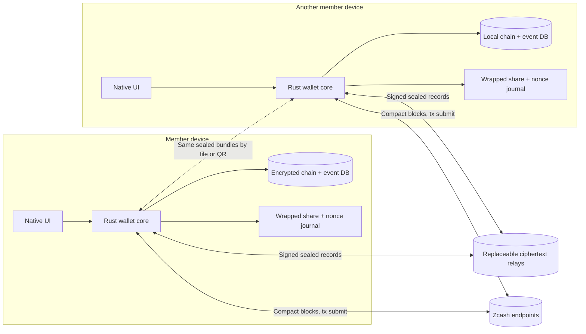

# Loki — Technical Implementation Specification

**Version:** 0.1 · 30 September 2026  
**Status:** proposed design with explicit feasibility and security gates  
**Companion:** [product requirements](LOKI_PRD.md) · [earlier design review](LOKI_WALLET_TECHNICAL_DESIGN.md)

## 1. Build contract

Build a **full Ironwood wallet** on each member device. A vault is a `t`-of-`n` FROST group with `2 <= t < n <= 6`. Each member has one spend-authorizing share, common vault viewing material, a local scanned chain database, and an authenticated device identity. The wallet can receive, scan, propose, review, approve, prove, broadcast, and recover without a privileged Loki server. An optional desktop client uses the same core.

The first release has two payment modes:

- **Prepared-subset mode:** when every member has enough safe nonce commitments and the candidate family is within measured limits, prebuild one unproved transaction candidate for each `t`-subset. A member verifies every candidate naming them, approves once, and emits the full share batch. Any `t` successful approvers complete a candidate without another contact.
- **Interactive mode:** if the preparation or cost gate fails, collect authenticated human approvals for an exact intent, choose a reachable subset, and run the remaining FROST exchange. The UI states that a later signing step may be required. It never presents this as tap-and-disconnect.

Both modes use the same on-device verifier, nonce journal, finisher, and chain state. No claim of one-tap approval is made for an unprototyped variant.

### Source status and assumptions

NU6.3/Ironwood has a specified mainnet activation height in [ZIP 258](https://zips.z.cash/zip-0258). [ZIP 229](https://zips.z.cash/zip-0229) makes shielded anchors authorizing data rather than signed transaction effects. The current [deferred PCZT builder](https://zcash.github.io/librustzcash/rustdoc/latest/zcash_primitives/transaction/builder/struct.DeferredPcztBuilder.html) is intended to sign before anchors, witnesses, and proofs. [ZIP 312](https://zips.z.cash/zip-0312) remains a draft and explicitly requires signers to check the transaction behind the sighash. The [ZF FROST audit statement](https://github.com/ZcashFoundation/frost/blob/main/README.md) covers an older release and excludes rerandomized FROST; Loki's integration requires its own review.

## 2. System boundaries



| Authority | Owns | Does not decide |
| --- | --- | --- |
| Zcash chain | Confirmed notes, nullifiers, expiry, and mined transaction | Whether a user understood a payment |
| Member device | Its share, nonce use, review decision, local scanned view, and valid signed events | Other members' consent |
| Group certificate | Vault identity, threshold, member identities, public key package, group epoch | Chain balance |
| Relay | Opaque message availability | Keys, balances, valid approvals, or finality |
| Push provider | Wake-up delivery | Proposal details |

A relay can delay, drop, replay, reorder, or fork messages. A lightwallet endpoint can withhold chain data, so the UI reports the endpoint and chain tip age and supports switching endpoints. Consensus validity comes from the Zcash network; an endpoint's balance report is never substituted for local note scanning.

## 3. Code boundaries and interfaces

Use one Rust workspace and native SwiftUI and Jetpack Compose shells. The initial API investigation uses `frost-core 3.0.0`, `frost-rerandomized 3.0.0`, `orchard 0.15.5`, and the matching `pczt`/`zcash_*` releases as **candidates**, not a proven compatible lockfile. M0 pins the exact set after a real regtest transaction; never assemble a release from individually latest crates. The wallet core is shared; platform-specific storage, background work, biometrics, notifications, and accessibility stay in the shells.

| Module | Responsibility | Small public interface |
| --- | --- | --- |
| `vault` | DKG, group certificate, ZIP 2005 derivation, backup, repair, migration | `create`, `join`, `verify_certificate`, `restore`, `repair` |
| `wallet` | Chain scan, notes, witnesses, reservation view, transaction construction and proof | `sync`, `balance`, `propose`, `prove`, `broadcast` |
| `approval` | Candidate-family verifier, display model, FROST package/share/aggregate, nonce journal | `review`, `approve`, `finish`, `retire` |
| `transport` | Canonical signed records, group/pairwise sealing, relay and file delivery | `seal`, `ingest`, `export_bundle`, `import_bundle` |
| `app` | Workflow orchestration and FFI | `vault_status`, `proposal_status`, `review_payment`, `approve_payment` |

No UI method accepts a raw sighash, nonce, randomizer, or FROST signing package. `review_payment` returns an immutable validated display model and a short-lived opaque approval handle bound to the exact proposal-manifest hash. `approve_payment(handle)` rechecks the handle, candidate bytes, epoch, and nonce state under a transaction lock. The FFI exposes structured refusal codes; no error path falls back to signing an unchecked digest.

## 4. Persistent model and event contract

### Local tables

| Table | Important fields | Rule |
| --- | --- | --- |
| `vaults` | vault ID, network, certificate hash, `t`, `n`, current epoch, birth height | Certificate changes only through a new epoch or new vault |
| `members` | member ID, FROST identifier, identity public key, certificate status | No self-declared signer identity |
| `chain_state` | scanned height/hash, subtree/witness state, endpoint observations | Reorg rolls back derived note state |
| `notes` | note ID, nullifier, value, received height, spent height | Chain is authoritative; reservation is separate |
| `proposals` | manifest hash, intent hash, candidate hashes, expiry, workflow state | Immutable after publication |
| `events` | signed record ID, sender, epoch, canonical bytes, applied status | Deduplicated by signed hash; out-of-order dependencies wait |
| `nonce_journal` | commitment ID, encrypted secret reference, epoch, assigned package, state | Transactional, monotonic state; excluded from backup |
| `share_outbox` | encrypted exact batch bytes, manifest hash, delivery status | Resend bytes; never recompute shares |
| `final_transactions` | signed candidate hash, final transaction bytes, txid, broadcast receipts | Saved before network submission |

Encrypt the wallet DB with a per-install key protected by the platform keystore. The nonce store is a separate, device-bound, non-backed-up store. A database backup may restore history and event records, but may **not** restore usable nonce secrets. Logs and crash reports omit notes, addresses, memos, shares, nonce material, and plaintext envelopes.

### Signed record header

Every inner record has canonical bytes for `protocol_version`, `network`, `vault_id`, `group_epoch`, `record_kind`, `record_id`, `sender_identity`, `sender_sequence`, `created_at`, `body_hash`, and `body`. Sign the domain-separated canonical encoding with an Ed25519 device identity key; then encrypt it for the group or a pairwise recipient. Pairwise setup/repair transport uses HPKE Base mode with a **certified recipient X25519 key**, HKDF-SHA256 and ChaCha20-Poly1305; the inner Ed25519 signature authenticates the sender after decryption. Group records use XChaCha20-Poly1305 under an independently rotatable group channel key. Pin the suite ID in the certificate and publish cross-device vectors. Verify the signature against the **certificate's identity-to-FROST-identifier map**, not an identifier supplied inside the record. Use a unique AEAD nonce and associated data binding protocol version, mailbox ID, vault ID, and epoch. Reject duplicate IDs with different bytes.

Required kinds are `GroupCertificate`, `CommitmentBatch`, `Retire`, `ProposalManifest`, `CandidateChunk`, `ApprovalBatch`, `Refusal`, `CancelRequest`, `FinalCandidate`, and `Execution`. Unknown critical versions fail closed. A manifest contains the exact intent hash, sorted candidate metadata, chunk hashes, expiry, input-nullifier-set hash, and all packages and randomizer seeds needed for signers to recompute candidate parameters. Large candidate PCZTs are content-addressed chunks; clients verify every hash before review. A signed `Execution` is a status hint; confirmation still requires chain sync.

Membership epochs are monotonically increasing. The initial `GroupCertificate` carries signatures from all setup members. A lost-device repair certificate carries signatures from **all surviving certified members** and the replacement device, plus a hash of the completed repair/refresh transcript; with `t < n`, at least `t` surviving members are available after one loss. If another member is unreachable, repair waits rather than silently weakening the certificate rule. A member accepts a new epoch only after validating its complete certificate and predecessor link. Records from older epochs cannot authorize new payments. Sequence numbers help deduplication, but a missing sequence does not permanently block a later valid record; dependencies are identified by hashes and fetched independently.

## 5. Vault creation and keys

1. The creator displays an authenticated invitation with network, `t,n`, setup ID, invitation secret, relay hints, Ed25519 identity key, and X25519 transport key. Each joiner contributes fresh identity and transport keys and checks the intended roster. Remote participants compare a short authentication string over an independent channel.
2. All members run the pinned RedPallas FROST DKG. Broadcast round-one packages and authenticated echoes of the **ordered complete round-one transcript**; any equivocation aborts. Round-two shares are pairwise encrypted and authenticated. The ciphersuite's even-y normalization is checked against the Orchard-family spend-validating key representation.
3. ZIP 2005 requires compatible common recovery/viewing material alongside the distributed spend key. Each member commits to a fresh contribution before any is revealed; the group reveals and authenticates contributions, compares the complete transcript, and derives the common root using a domain-separated KDF. No address is shown if any member sees a different root, `ak`, transcript, or member list. This is an **integration design requiring a written secrecy/agreement argument and external review**, not a claim that plain DKG establishes it automatically.
4. Derive Ironwood viewing components using the exact deployed ZIP 2005 branch and test vectors. Each device independently derives the same viewing key and first receive address. A certificate signed by all setup participants binds network, `t,n`, identifiers, Ed25519 identity and X25519 transport keys, DKG transcript hash, group public key, viewing-key fingerprint, cryptographic suite IDs, derivation version, and birth height.
5. The group creates encrypted Group Cards. Each card contains that member's FROST key package and one threshold share of the common recovery/viewing root, plus public group data. **No nonce secrets** enter a card. Select a documented, tested share encoding and encryption profile at Gate 3; use a maintained library and an independent reader. Every member validates the card set against the certified root; run a `t`-card reconstruction drill before deposit addresses become active. A card's holder must keep both card and recovery phrase.

The common viewing material gives every current member full vault history. A copied member device may retain it forever. The ZIP 2005 `qsk` recovery property is not represented as quantum-resistant threshold custody. Transport channel keys are derived with separate domain labels and can be rotated without asserting that viewing access has been revoked. [ZIP 2005](https://zips.z.cash/zip-2005).

## 6. Chain sync and transaction construction

Each phone scans Ironwood compact blocks with the certified viewing material, persists discovered notes/nullifiers/memos and witness data, and handles reorg rollback. An offline device may display cached state and queue sealed records; it cannot claim a fresh balance or confirmation. Note selection excludes locally reserved notes, but two concurrent proposals may still race to spend the same inputs.

The proposer forms an immutable `PaymentIntent`:

```text
network, vault_id, group_epoch, proposal_nonce,
ordered recipients {exact receiver, zatoshis, memo bytes},
change receiver policy, real input nullifiers, fee, expiry_height,
allowed pool = Ironwood, construction_version
```

The intent's human annotation and contact labels are outside the signed effect model. The wallet derives a fee with the deployed ZIP 317 rule and applies a conservative configurable cap; the verifier checks the actual value balance and cap. Expiry is a signed height chosen by a documented wallet policy and shown as an approximate time. Do **not** apply [ZIP 318](https://zips.z.cash/zip-0318)'s migration-specific expiry recipe to ordinary payments. Proposals nearing expiry are marked for rebuild before signers waste approvals.

Build v6 Ironwood PCZTs with deferred anchor and witnesses. For prepared-subset mode, each candidate may have a different `rk` and ciphertext but must use the **same real input nullifier set** and the same external payment semantics, verified change, fee, and expiry. This matters: if two candidates use disjoint inputs, both may mine and double-pay. Note count, dummy actions, padding, and all output bytes must be accounted for by the verifier; no unknown output is silently ignored.

After a candidate is fully signed, a synced finisher installs an anchor and spend witnesses valid for the selected notes, proves only that candidate, verifies the extracted transaction locally, saves final bytes, then submits through two independent endpoints. A stale witness may be rebuilt while the signed effects and expiry remain unchanged. If the inputs have been spent or the expiry passed, the candidate is terminal and a new proposal requires new approvals. [ZIP 229](https://zips.z.cash/zip-0229), [ZIP 374](https://zips.z.cash/zip-0374).

## 7. Prepared-subset signing, precisely

### Feasibility dependency W1

Current [`orchard` builder code](https://docs.rs/orchard/latest/src/orchard/builder.rs.html) samples each spend's `alpha` internally. Prepared-subset mode needs the builder to accept a **caller-supplied, per-real-spend `alpha`** derived by the pinned `frost-rerandomized` path, and needs the resulting PCZT's `rk`, sighash, signing package, and later proof to agree. Prototype an upstream API or a small maintained patch first. Never edit `alpha` and `rk` in an already built PCZT without rebuilding every dependent value and passing consensus tests.

### Commitment inventory and candidate construction

Every member preprocesses nonce pairs using the pinned FROST library and publishes authenticated public commitments. Secret pairs remain on that device. A commitment is identified by a hash of vault, member, device epoch, public nonce pair, and creation sequence. For `m` real spend actions, a member needs at least `C(n-1,t-1) * m` fresh commitments for **one** full candidate family; pending proposals need separate inventory. The proposer offers strict tap-and-disconnect only if all `n` members satisfy this requirement. If only a subset is stocked, the UI uses interactive mode rather than saying “any `t`.”

For each sorted `t`-subset `S` and each real spend action `k`:

1. Select one distinct commitment for each member of `S`; no commitment may occur in another package, candidate, action, or proposal.
2. Derive the rerandomization seed/parameters from that commitment set using `RandomizedParams::new_from_commitments` in the pinned library. The seed is included in the encrypted proposal so each signer can call `regenerate_from_seed_and_commitments`. A seed supplied by an arbitrary coordinator without this path is rejected. [Library documentation](https://docs.rs/frost-rerandomized/3.0.0/frost_rerandomized/).
3. Construct that candidate PCZT with the corresponding per-action `alpha`; compute its v6 sighash **locally from the candidate** and form a sorted FROST signing package. Publish the complete candidate-family manifest before any signer approves.

Costs are `C(n,t)` PCZTs and `C(n-1,t-1)*m` shares per member. The initial product permits groups through six, but the prepared-mode limit is based on **measured** CPU, bytes, battery, nonce inventory, and one winning proof. For example, 3-of-5 needs ten candidate PCZTs and six shares per real spend action. No hard-coded “16 commitments covers every vault” assumption is allowed.

### Signer approval transaction

`approve_payment(handle)` performs these steps under a per-vault signing lock:

1. Revalidate the certificate, group epoch, immutable manifest, all candidate hashes, intent, and local policy. Run the full verifier in section 8 on **every** candidate, not only those naming this signer; then verify every package naming this signer.
2. Confirm each local commitment was published by this device, remains in the current epoch, and is assigned **only** to this manifest and package. Confirm all other commitments are authenticated to certified members. Concurrent proposal races are resolved by the local assignment journal; a losing proposal is refused or rebuilt.
3. Obtain biometric/passcode consent for the immutable reviewed display. Unseal the assigned nonce secrets into volatile memory, then use **one transaction in the separate nonce store** to mark every nonce in the batch `Spent` and remove its persistent ciphertext. Commit and fsync before computing shares in memory with the pinned rerandomized FROST API. Persist the exact signed/encrypted `ApprovalBatch` to the outbox **before** attempting delivery. Zeroize transient secrets.
4. Retry the persisted bytes through available transports. A retry never calls FROST signing again. If the process dies after nonce consumption but before the batch is saved, those candidate slots are lost; a fresh proposal or interactive session is required. The UI does not claim success until the batch is safely queued.

This favors safety over availability at the crash boundary. The PRD's one-tap metric counts **successfully queued** approvals. A phone that is powered off after that point need not answer a later round. If two proposers claim the same commitment, the signer accepts only the first durable local assignment and refuses the other manifest; the losing payment needs new commitments and approvals. The product's any-`t` claim applies to a valid, nonconflicted candidate family.

### Finishing and faulty shares

Identify a share's participant from the authenticated sender/certificate mapping and package slot; never trust a self-declared FROST identifier. Verify each share with the rerandomized share-verification API. A bad share gets a signed fault record with evidence sufficient for another member to reproduce verification, excluding secret material. That candidate cannot be repaired by swapping a signer into its fixed package; another prebuilt candidate or fresh session is needed. Once one candidate has `t` valid shares for **every real spend action**, aggregate and locally verify all final spend signatures before proving. Persist the selected signed candidate so another member can finish if this device disappears. The first candidate mined wins because all candidates share the same nullifiers. Alternate fully signed candidates are not broadcast by honest clients; a malicious threshold can reveal them and create linkage.

## 8. Signer verification and display binding

The signer sees a complete, immutable candidate PCZT, not only a hash. A redacted signer view is usable only after tests prove it retains every field needed for the checks below. The verifier and low-level signer must consume the **same exact bytes**; otherwise a time-of-check/time-of-use substitution is possible. The signer checks:

| Check | Required evidence | Refusal category |
| --- | --- | --- |
| Format | V6/NU6.3 branch, network, Ironwood-only effects, parsable PCZT | `format_or_network` |
| Source | Real spend notes and nullifiers belong to this vault; no unexpected input | `source_mismatch` |
| Randomization | Per-spend `alpha`, `rk`, commitment set and seed recompute correctly | `randomizer_mismatch` |
| Outputs | Every output commitment and encrypted note matches disclosed recipient, value, memo and rseed; all outputs classified | `output_mismatch` |
| Change | Receiver is derived from this vault's permitted change path | `change_mismatch` |
| Balance/fee | Real inputs, outputs and value balance imply displayed fee within policy | `fee_mismatch` |
| Timing | Signed expiry is the displayed deadline; deferred anchor is never described as signed | `expiry_mismatch` |
| Family | All candidates have identical real nullifier set and semantic effects | `candidate_mismatch` |
| FROST | Package message equals locally computed sighash; sorted authenticated commitments; local nonce unused | `package_mismatch` |

The UI renders only the verifier's typed `ReviewModel`. It shows all external recipients, exact values and memos, verified change, fee, expiry, and first-time-recipient status from the local history. Full receiver bytes are available without truncation; contact names and proposer notes are explicitly annotations. An absent opening, redacted output field, or unverified memo is a refusal. Validation must account for dummy actions and all components; a fee is computed from the entire transaction, not from a proposer-supplied number.

The signed v6 effects include expiry and transaction actions but exclude shielded anchors, which the prover supplies later. Tests mutate each committed effect and require either a different locally computed sighash or a verifier refusal. Tests also mutate display-only labels to confirm they cannot silently replace a verified recipient. [ZIP 229](https://zips.z.cash/zip-0229), [PCZT signer contract](https://zcash.github.io/librustzcash/rustdoc/latest/src/pczt/roles/low_level_signer/mod.rs.html).

## 9. Nonce and restore safety

Nonce states are `Generated -> Published -> Assigned(proposal,candidate,action) -> Spent` or `Retired`. The only transition that uses a secret is `Assigned -> Spent`. It is committed durably **before** share computation, and the persistent sealed nonce bytes are removed in the same transaction. A spent, retired, or uncertain commitment is never reassigned, even if a relay reports otherwise. A signed retirement event helps peers avoid dead commitments; it is not the local safety mechanism.

The nonce store is excluded from supported cloud backups and device transfers, sealed to a non-exportable device key, and checked at startup. On reinstall, transfer, restore, key mismatch, journal corruption, or an uncertain exclusion marker, the app starts a new device epoch and refuses every old nonce. A `ThisDeviceOnly` keychain attribute alone is insufficient for a same-device backup restore. Platform tests must exercise iCloud, Finder, Quick Start, Android cloud backup, Android device transfer, reinstall, and same-device restore. A privileged attacker that can roll back **all** local state on the same hardware is outside the initial threat model unless a proven non-rollback primitive is added. Relay consumed indexes are monitoring aids, never part of the nonce uniqueness proof. [RFC 9591](https://www.rfc-editor.org/rfc/rfc9591.html), [Apple accessibility](https://developer.apple.com/documentation/security/restricting-keychain-item-accessibility).

## 10. Transport and reconciliation

The default is two independently operated, open-source ciphertext relays. A relay offers `PUT envelope`, `GET after cursor`, and a live stream for waking open clients; chunk bodies are content-addressed and bounded in size. Every upload is idempotent by ciphertext hash. Clients write each signed sealed record to all configured relays, then merge by signed record hash. Weekly rotating mailbox IDs reduce stable identifiers but do not hide IP, traffic timing, retrieval pattern, or push-token linkage. Rate limits and storage quotas prevent unauthenticated abuse; neither changes vault security.

One client can export a sealed proposal or approval bundle as a file and another can import it. This is the required fallback if Loki relays vanish; small control messages may also travel by QR. The file contains the **same** signed inner records and hashed chunks as the relay path, so verification does not fork by transport. With all relays down and no other delivery channel, liveness is impossible; the product does not claim otherwise. On-chain memos are a later, explicitly funded and privacy-reviewed option.

Push messages contain only an opaque wake-up token. The app fetches and decrypts after opening or permitted background wake. Push off or unavailable means the member catches up on next open. Do not assume iOS or Android will finish an interactive FROST round in the background.

Reconciliation order is: authenticate envelope; validate certificate/epoch; deduplicate by signed hash; fetch missing manifest chunks; validate causal dependencies; apply the event; update local UI. A valid record is never deleted merely because one relay omitted it. Devices detect conflicting certified records by ID and surface a group warning. The encrypted group log is an audit aid, not chain finality or a global consensus service.

## 11. Proposal, expiry, and concurrency state machines

```text
Draft -> Published -> Collecting -> Authorized -> Proving -> Broadcast -> Confirmed
                    |             |             |           |
                    +-----------> Expired / Conflicted <------+ 
```

`Refusal` is a member event and does not globally close a proposal. `CancelRequest` asks cooperative clients to stop; once a valid share leaves a device, it cannot be recalled. Hard expiry is the signed chain height. If a confirmed competing transaction spends any input, the proposal becomes `Conflicted`; replacement means a new intent version, fresh candidate PCZTs, fresh nonces, and fresh approvals. A local reservation prevents accidental selection of the same note by one device, but multiple devices may race. The UI reports this as tentative.

The finisher lease is advisory. Any member with the complete signed candidate and current chain data may take over proving and broadcasting. Multiple finishers may waste CPU, but they cannot cause two candidate copies with identical input nullifiers to both mine. Persist final transaction bytes before first broadcast. Retries use those bytes; do not rebuild a transaction and ask signers again for a transient network error.

## 12. Recovery, rotation, and export

| Situation | Procedure | Address | Limit |
| --- | --- | --- | --- |
| Device lost, old share not copied | `t` surviving helpers repair the share; distribute viewing material over authenticated encryption; refresh active shares; new epoch and certificate | Same | Cannot help if fewer than `t` helpers or valid cards survive |
| Backup restoration | Independent reader decrypts `t` cards, validates certificate, reconstructs required key material, starts fresh device epochs and nonce stores | Same if group retained | A card set must be verified before deposits |
| Share possibly copied/stolen | New DKG vault, threshold-approved shielded sweep, retire old addresses in UI | New | Same-key refresh cannot erase copied historical material |
| Member departs or future history must be hidden | New vault and sweep | New | Former member retains old viewing key |
| Threshold changes or member added | New vault and sweep | New | V1 does not implement same-key resharing |

For the ordinary-loss path, use the pinned FROST repair API followed by refresh. A successful refresh invalidates one *old* share against the new participant package, but a copied threshold of old shares can still reconstruct/sign under the unchanged group public key. The UI and documentation must say this clearly. No recovery path is advertised below threshold. [ZF FROST](https://frost.zfnd.org/frost.html).

Export includes the exact ciphersuite, public key package, member identifiers, a member's encrypted key package, viewing material, derivation/version, vault birth height, and network. Do not call a tool-specific file “standard” unless an independent implementation imports it and performs a regtest spend. The independent reader and at least one tested export format are release dependencies, not stretch goals.

## 13. Threat model and claims

The adversary may control the builder, any relay, push, and network schedule, and corrupt fewer than `t` members. Honest signer devices run the reviewed code and protect local keys. It may delay every channel forever; therefore liveness is conditional on delivery and a proving/broadcasting member. We do not claim safety against malware on `t` phones, a copied threshold of historical shares, a privileged same-device rollback outside the tested platform model, or future confidentiality from someone who copied the vault viewing key.

| Claim after gates | Argument and evidence needed |
| --- | --- |
| Threshold authorization | Rerandomized FROST sessions remain unforgeable for the actual Mode A multi-candidate schedule; written reduction/review and real Ironwood test vectors |
| Approval binding | Same-byte PCZT verifier and signer; field-to-sighash map and mutation tests, including outputs, memo, fee, expiry, and candidate family |
| Nonce single use in tested model | Durable consume-before-sign journal; crash-point model and platform restore matrix |
| Conditional any-`t` availability | Complete candidate family with stocked commitments from all `n`; schedule tests across all `t`-subsets and one-member outages |
| Server independence | Restore and spend with Loki relays removed using file exchange and independent chain endpoints |
| Infrastructure content confidentiality | No plaintext fields or keys in relay/push logs; authenticated encryption and negative tamper tests |

## 14. Architecture decisions

| ADR | Decision and reason | Cost / rejected alternative |
| --- | --- | --- |
| A1 | **Full wallet on every member device.** Local scanning and proving remove the Desk as a balance and execution dependency. | More mobile sync/proving work; signer-only companion rejected for this product goal. |
| A2 | **Prepared subsets only where measured.** They turn FROST's second human visit into advance work and permit any stocked `t` members. | Combinatorial PCZT/share/nonce cost; generic “one copy” needs another round. |
| A3 | **Prove the selected v6 candidate after authorization.** V6 excludes the anchor from the sighash. | Broadcast latency includes proof; proving every candidate up front costs much more. |
| A4 | **Use tested FROST/Zcash libraries.** Loki owns integration and policy, not new curve arithmetic. | Caller-selected `alpha` may require an upstream patch; arbitrary PCZT mutation is rejected. |
| A5 | **Relay plus identical sealed-file protocol.** Relays make UX fast; files preserve independence. | Manual fallback is slower; automatic chain-memo fallback has fee and metadata cost. |
| A6 | **New vault for serious compromise or membership changes.** Same-key refresh cannot revoke copied history or old threshold shares. | New address and sweep fee; same-address convenience rejected where it gives false security. |
| A7 | **Nonce safety is local.** Consume-before-sign and non-backed-up storage are authoritative. | Lost shares after some crashes; malicious relay indexes cannot prove uniqueness. |

## 15. Implementation sequence and gates

Each milestone closes with its evidence. Do not build app shells around Mode A until M0 passes.

| Milestone | Build | Exit evidence |
| --- | --- | --- |
| M0 — cryptographic feasibility | Pin dependency set; caller-selected per-spend `alpha`; v6 Ironwood PCZT; 2-of-3 rerandomized FROST; deferred anchor/witness/proof | Regtest spend mined; signer independently recomputes candidate parameters; no PCZT field patched after signing |
| M1 — wallet core | Phone-compatible Ironwood sync, receive, note selection, proof, broadcast, reorg handling | Two simulated devices agree after deposit/reorg; one real phone sends without Desk |
| M2 — setup and recovery root | DKG, transcript echo, ZIP 2005 derivation, group certificate, Group Cards, independent reader | All devices derive same address; equivocation aborts; `t`-card restore and regtest spend |
| M3 — verified payment | Intent, candidate family, typed review model, field binding, interactive FROST baseline | Tamper corpus yields named refusals and zero shares; exact signed bytes validated |
| M4 — asynchronous mode | Commitment board, local nonce journal, share batch, relays, file fallback, finisher takeover | Every subset schedule passes; crash/restore matrix proves no tested nonce reuse; relay-shutdown spend |
| M5 — native UX and recovery | SwiftUI/Compose, accessibility, push, lost-device repair, compromised-device migration | Real-device usability tests, repair drill, migration drill, measured latency/battery |
| M6 — release | External review of DKG/ZIP 2005, Mode A, PCZT verifier, nonce store; small-value canary | All gates closed, documented residual risks, repeatable release build and canary history |

If M0 fails, keep the full wallet scope and replace prepared-subset mode with an explicit interactive FROST flow. If mobile proof latency misses user expectations, the UI reports proof progress and any synced member desktop can finish; do not claim a fixed last-approval-to-broadcast time without real measurements.

## 16. Test matrix

- **Consensus integration:** real NU6.3 regtest transactions for every supported threshold, one/multiple real spend actions, dummy actions, memos, fees, expiry, deferred anchor and witness installation, and proof after signature.
- **Transaction tampering:** wrong recipient, amount, memo, fee, change, source nullifier set, extra output, randomizer, package message, branch, pool, candidate count, and expired height. A signer produces no share and returns the expected refusal class.
- **Scheduling:** every `t`-subset up to six members; approval order permutations; one missing member; bad authenticated share; signer or finisher crash; concurrent proposals with overlapping notes; duplicate/reordered/censored relay messages.
- **Nonce:** crash before and after each journal commit and outbox write; process kill between share computation and upload; OS backup/restore/transfer on supported iOS and Android versions; epoch retirement. Check no repeated secret pair is ever used.
- **Wallet:** compact-block reorg, stale endpoint, note conflict, broadcast retry using saved bytes, final chain confirmation, full relay shutdown and sealed-file handoff.
- **Recovery:** lost share repair followed by refresh and same-address test payment; old single share rejected; copied old threshold signs in a controlled negative test to keep the warning honest; new-vault sweep; `t`-card independent restore.
- **Product:** screen reader, large text, offline cached-state labels, first-time-recipient warning, untrusted annotation separation, interactive-mode disclosure, push-off operation, and user comprehension of “authorized” versus “confirmed”.

Previous research in [SUMMARY.md](SUMMARY.md) reports a FROST spike but no real signed PCZT or network spend. Treat it as research until its source and fixtures are placed in this workspace and rerun. M0 is the first actual end-to-end proof of this architecture.

## 17. Open gates before funded use

1. **W1:** caller-supplied `alpha` through the actual Orchard-family builder and proof path. This is the first build task.
2. **W2:** reviewed DKG plus ZIP 2005 common-root agreement and correct Ironwood derivation.
3. **W3:** exact, independently readable Group Card encoding and encryption profile.
4. **W4:** byte-complete on-device PCZT verifier, including memo/output binding and dummy actions.
5. **W5:** tested same-device and migration restore behavior on every supported OS version.
6. **W6:** benchmarked candidate construction, share batch, payload size, mobile proof, battery, and last-approval-to-broadcast time.

These gates are deliberate dependencies, not implementation details to fill in after mainnet launch. The product may ship an interactive testnet wallet while a gate remains open; it must not market the gated one-tap or recovery claim as complete.

## 18. Primary references

- [RFC 9591 — FROST](https://www.rfc-editor.org/rfc/rfc9591.html)
- [ZIP 312 — rerandomized FROST for Zcash](https://zips.z.cash/zip-0312)
- [ZIP 2005 — Ironwood quantum recoverability](https://zips.z.cash/zip-2005)
- [ZIP 229 — version 6 transaction format](https://zips.z.cash/zip-0229)
- [ZIP 258 — NU6.3 deployment](https://zips.z.cash/zip-0258)
- [ZIP 374 — partially created transaction format](https://zips.z.cash/zip-0374)
- [ZIP 317 — fee mechanism](https://zips.z.cash/zip-0317)
- [ZIP 203 — transaction expiry](https://zips.z.cash/zip-0203)
- [ZIP 318 — Orchard-to-Ironwood migration](https://zips.z.cash/zip-0318)
- [ZF FROST implementation and audit scope](https://github.com/ZcashFoundation/frost/blob/main/README.md)
- [Rerandomized FROST API](https://docs.rs/frost-rerandomized/3.0.0/frost_rerandomized/)
- [Orchard builder source](https://docs.rs/orchard/latest/src/orchard/builder.rs.html)
- [Deferred PCZT builder](https://zcash.github.io/librustzcash/rustdoc/latest/zcash_primitives/transaction/builder/struct.DeferredPcztBuilder.html)
