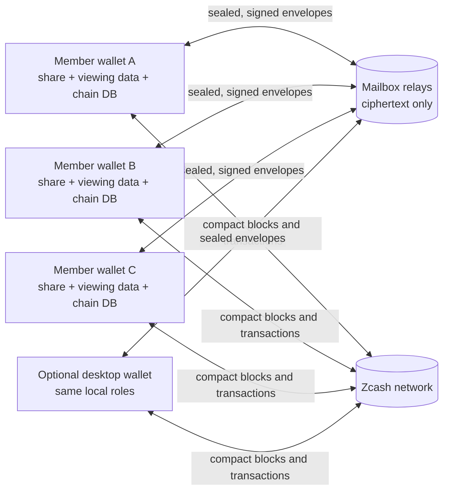

# Loki: private group wallet for Zcash

**Proposed product and technical design — 30 September 2026**  
**Status:** design for review, not a security proof or a release claim

## 1. Decision in one paragraph

Loki is a full, local-first wallet for a group that holds shielded ZEC. A member can receive funds, inspect the vault's balance and history, propose a payment, review it on their own device, approve it, and follow it through confirmation. The spending key is created as FROST shares; no device or service ever holds the complete classical spend-authorizing key. Member devices hold the vault's viewing material and their local wallet databases. An untrusted, replaceable mailbox delivers encrypted group messages. Loki begins with Ironwood and small `t`-of-`n` groups. Its central experiment is whether a member can review a *real, locally verified transaction*, approve once, and leave while any later quorum completes the spend.

The first release's **one human decision per payment** promise applies to proposals that pass the prepared-subset gate in section 8. Other transaction shapes use an explicit interactive flow until background signing is proven safe and reliable. The stronger promise that the phone may immediately power off after the tap is a separately gated capability. A mobile OS cannot be assumed to run a later FROST round or unlock a biometric-gated share in the background.

## 2. Assessment of the 30 September draft

The original draft identifies the right product pressures: threshold custody, asynchronous approvals, independent transaction review, private transport, and device recovery. Its Mode A idea is worth prototyping. Several statements need correction before they become requirements or guarantees:

| Issue | Why it matters | Correction in this design |
| --- | --- | --- |
| Phones are called local-first wallets, but only the Desk has a scanned wallet database | A phone would depend on a Desk for its balance, receiving history, and new proposals | Each phone owns a local view-only chain database and can construct, prove, and broadcast; desktop is an optional faster client |
| ZIP 318's anchor and expiry recipe is used for ordinary vault payments | [ZIP 318](https://zips.z.cash/zip-0318) specifies an **Orchard-to-Ironwood migration** schedule, not a general payment policy | Use [ZIP 203](https://zips.z.cash/zip-0203) expiry semantics and an explicit wallet policy; evaluate fingerprinting separately |
| The approval-binding table says the v6 sighash commits to the anchor | [ZIP 229](https://zips.z.cash/zip-0229) deliberately excludes v6 shielded anchors from the txid and sighash | Signers bind the payment effects and expiry; the prover chooses a valid anchor later and verifies witnesses and proofs |
| Copies are required to show the same payment, but their inputs are not explicitly compared | Two copies using disjoint notes could both be mined and pay twice | Every candidate must have the same set of real input nullifiers, fee, expiry, and semantic outputs; all candidates are checked as one family before any share is released |
| A restore marker and two relay queries are claimed to prove nonce uniqueness against malicious relays | A same-device backup can restore `ThisDeviceOnly` items; excluded-file attributes can be reset. An adversarial relay can lie. [Apple accessibility](https://developer.apple.com/documentation/security/restricting-keychain-item-accessibility), [backup exclusion](https://developer.apple.com/documentation/foundation/urlresourcekey/isexcludedfrombackupkey) | Keep nonce secrets out of all supported backups and transfers, use a local consume-before-sign journal, test each platform restore path, and state the rollback limit explicitly. Relay observations are diagnostics, not the security argument |
| Refresh is described as making a stolen or former member's share useless | Previously copied **old** threshold shares can still sign under the unchanged group key; the former member also retains the vault viewing key. [ZF FROST guidance](https://frost.zfnd.org/frost.html) warns about this | Repair/refresh is offered for lost-device continuity. For confirmed theft, departure with confidentiality needs, or a threshold change, create a new vault and move funds |
| Infrastructure is said to learn only size, time, and rotating mailbox IDs | A relay also sees source IPs, retrieval patterns, and push tokens; two relays can collude | Promise ciphertext confidentiality and authenticated contents. Treat traffic analysis as a residual risk; offer push-off and network-privacy controls |
| Every subset is proved up front | `C(n,t)` proofs and full PCZTs raise CPU, battery, bandwidth, and mailbox costs without a measured need | Build and authorize **unproved** candidate PCZTs; after a quorum completes, prove only the winning copy, using v6 deferred-anchor support in [ZIP 374](https://zips.z.cash/zip-0374) |
| Chain memos are an automatic free fallback | They cost ZEC, require a funded broadcaster and chain access, and may link participants through traffic | Export/import encrypted proposal bundles as the required independent transport. Chain memos are an optional later feature with a measured privacy and fee budget |
| Cancellation and reservations are presented as if they control released shares | A released valid share cannot be recalled, and reservation is a local wallet rule | Cancellation is advisory after shares leave a device; expiry or a conflicting mined spend provides the hard boundary. Show reservations as *pending*, not chain-locked funds |
| `t = n` is allowed while one lost phone is promised to be recoverable | Losing one member leaves fewer than `t` live shares, so helper-based repair cannot start | The initial product requires `t < n`; the UI explains exactly how many members may be unavailable |

Two additional limits belong in the product copy. First, every member given the vault viewing key can read its entire history. Second, [ZIP 2005](https://zips.z.cash/zip-2005) places a `qsk`-derived recovery capability with each member; its future post-quantum security story is **not** a `t`-of-`n` guarantee against an adversary with `qsk`. Neither is solved by an encrypted relay.

## 3. User and release scope

The first user is a small treasury with people in different places and a meaningful amount of shielded ZEC. A personal 2-of-3 across devices uses the same vault model. A vault chooses `2 <= t < n <= 6` at creation; keeping at least one spare member is necessary for the promised lost-device recovery. The interface recommends 2-of-3 and 3-of-5, but the protocol does not encode those as special key types. Changing `t` creates a new vault.

The first public release supports Ironwood receive, balance, history, memos, contacts stored locally, proposal, review, approval, proof, broadcast, confirmation, encrypted export, and lost-device recovery. Phones are real wallets: they scan compact blocks into an encrypted local database and can prepare a payment. Desktop may do the same work faster. No hosted helper holds a unified viewing key.

The initial release does not promise unattended signing from a locked phone, arbitrary group size, programmable spending policies, transparent or Sapling vault funds, or on-chain mailbox fallback. One-tap-then-disconnect is enabled only for group sizes and transaction shapes that pass the Mode A gates in section 8.

## 4. User experience contract

The vault home shows **confirmed**, **available to propose**, and **tentatively reserved by pending payments**. It shows the last chain-sync height and time. A member can always open the cached vault while offline; new deposits and confirmations appear after chain sync. Pending group events appear after mailbox sync. These are separate freshness indicators.

A payment moves through `Draft -> Awaiting approval -> Authorized -> Proving -> Broadcasting -> Confirming -> Confirmed`. It may instead become `Refused`, `Expired`, `Conflicted`, or `Needs attention`. “Authorized” never appears as “Sent”. Every state has a plain-language explanation and a next action. All members see proposals and signed approval receipts; no member outside the selected signing set has a veto.

The review screen is rendered from a validated PCZT, not proposer-supplied display text. It shows every external recipient, exact amount, memo, fee, verified change, the expiry height translated to an approximate time, and whether the recipient has been paid before according to that device's local history. Contact names and proposer notes are visibly labeled as local annotations. Address expansion is one tap away. A refused transaction names the failed check without producing a signature share.

A normal approval requires opening the request, reviewing the payment, and one biometric or passcode action. The device may do several cryptographic operations under that one consent. If it cannot guarantee completion without another visit, the UI says so **before** approval. A content-free push is optional; the mailbox is checked whenever the app opens.

Setup presents member and backup progress, then a short group code that members compare over an independent channel before funding. Recovery begins by asking whether the device is *lost* or *possibly copied/stolen*. Those paths have different security consequences.

## 5. Trust and privacy model

**Chain:** authoritative for note existence, spends, expiry, and confirmation.  
**Member wallet:** authoritative for its own share, local verification, consent, nonce state, and locally scanned view of chain history.  
**Encrypted group log:** signed records of proposals, approvals, refusals, and status. Each device validates and persists records; a relay can withhold or reorder them but cannot make a forged member event valid.  
**Mailbox:** store-and-forward delivery, not a balance oracle or signing authority. It may be unavailable or malicious.  
**Coordinator, builder, prover, finisher:** temporary roles taken by a member device. A role can move after a crash. The coordinator can cause delay and traffic leakage; it cannot spend without threshold shares.

The security model permits fewer than `t` compromised members, a malicious builder, and hostile relays. It assumes honest signer devices execute the reviewed release and protect their local secrets. It does **not** promise safety from malware on `t` signer devices, a stolen threshold of old backups, or confidentiality from a current or former holder of the vault viewing key. A lightwallet server and push provider see network metadata; Tor or a similar route can reduce, not eliminate, correlation.

## 6. Keys, setup, and backup

Use the Zcash Foundation's RedPallas rerandomized FROST implementation and its DKG; do not implement threshold arithmetic in Loki. Each member has a distinct, authenticated transport identity. Setup broadcasts DKG material consistently, delivers round-two packages pairwise encrypted, and certifies one common transcript, group verification key `ak`, viewing key, member list, `t`, `n`, and network. Any mismatch aborts before a deposit address is shown. The setup protocol and ZIP 2005 key derivation need independent cryptographic review before mainnet funding; the draft's commit/reveal argument is a proposal, not an established proof. [ZIP 312](https://zips.z.cash/zip-0312), [ZF FROST](https://frost.zfnd.org/), [ZIP 2005](https://zips.z.cash/zip-2005).

Each phone holds only its own FROST signing share. Members receive the viewing material needed to scan the vault and, where required by ZIP 2005, the common `qsk`-derived material. Keep the transport encryption secret independent of the viewing root so that transport keys can rotate without changing the vault address. Secure Enclave or Android Keystore protects local encryption keys; RedPallas FROST operations still run in app memory after authorized unwrapping. Apple's app-facing Secure Enclave signing interface is P-256, not RedPallas. [Apple Secure Enclave](https://developer.apple.com/documentation/security/protecting-keys-with-the-secure-enclave).

A **Group Card** is an encrypted, versioned export of one member's key package, identity and group metadata, plus one threshold backup share of the common viewing/recovery root. It never contains nonce secrets. Use an existing interoperable threshold-secret format and test vectors; do not implement a new GF(256) Shamir scheme or derive its coefficients from `sk`. Because each live member already knows the common root, one member may generate the card split, but all members must verify the resulting backup set against the certified root before deposits are enabled. The precise card encoding, share format, encryption parameters, and independent recovery reader are blocking Gate 3 decisions, not unspecified defaults. Each card has an independent recovery phrase and an explicit offline storage instruction. Restoring `t` cards and their phrases must be demonstrated in a drill; an untested card is not counted as recovery.

An export format for leaving Loki must document the exact FROST ciphersuite, group public package, each member package, viewing material, Ironwood derivation, birth height, and protocol version. A `frost-client` credential export may be offered only after an independent tool actually imports it and spends on regtest. Tool-specific credentials are not called a standard format.

## 7. Full wallet sync and transaction construction

Each device scans Ironwood compact blocks with its local viewing data and maintains note, nullifier, witness, transaction, and memo state in an encrypted local database. The proposer must have chain state fresh enough to select spendable notes and build a valid transaction. A signer can review a self-contained PCZT without performing a long foreground scan, but its displayed balance may be stale, and PCZT verification alone does not prove that a supplied note is currently unspent on-chain.

The proposer creates one **payment intent** containing the network, vault and group epoch, exact full recipient bytes, values, memo bytes, verified change destination, selected real input nullifiers, fee policy, and expiry. The interface displays a tentative reservation for those inputs. Concurrent proposals may race; the first mined spend wins. Devices reconcile reservations against the chain, not against whichever relay spoke first.

For a v6 Ironwood spend, the wallet builds candidate PCZTs with the same semantic effects and real input nullifier set. The wallet can defer the anchor, witnesses, and proof until after signing: v6 signatures do not commit to the anchor. The final prover must install a valid recent anchor and witnesses and produce a proof before broadcast. This is supported by the PCZT design and current deferred builder path, subject to the caller-supplied-randomizer dependency in section 12. [ZIP 374](https://zips.z.cash/zip-0374), [deferred PCZT builder](https://zcash.github.io/librustzcash/rustdoc/latest/zcash_primitives/transaction/builder/struct.DeferredPcztBuilder.html).

Expiry is an explicit chain-height field signed as part of the transaction. The default is a reviewed wallet policy, chosen with chain-validity, mempool, and privacy analysis; it is **not** copied from ZIP 318's migration schedule. An approver sees the deadline. After expiry, Loki builds a new proposal that needs fresh approval. A user-facing Cancel record can stop cooperative clients, but cannot revoke already released shares; the chain expiry is the hard time limit.

## 8. Approval protocol and the one-tap gate

### Mode A: prepared subset candidates

For an eligible proposal, enumerate each `t`-subset of the `n` members. Eligibility requires enough fresh, authenticated commitments from **every** member for all of that member's candidate/action slots; otherwise the wallet cannot promise that *any* `t` members may approve once and leave. The UI shows the missing inventory and uses the interactive fallback instead. For every real spend action in each subset, assign a distinct prepublished nonce commitment from each included signer. Derive that candidate's rerandomizer from its commitment set using the pinned `frost-rerandomized` API, construct its PCZT, and compute its sighash. Candidates may differ in `rk`, ciphertext, and proof data, but **all must match the intent's input-nullifier set, recipients, amounts, memos, change, fee, and expiry**. Signers verify the complete candidate family before releasing any share. [frost-rerandomized](https://docs.rs/frost-rerandomized/latest/frost_rerandomized/).

At approval, a signer validates every candidate that contains it, consumes a separate nonce pair for each candidate and spend action, and emits one encrypted batch of shares. The first subset to collect all valid shares for all real spend actions becomes the winner. Because every candidate spends the same real notes, only one candidate can be mined. An honest finisher broadcasts only the selected candidate and does not deliberately leak alternate signed transactions. A malicious threshold can still reveal them; the resulting nullifier linkage is a privacy risk.

Cost is `C(n,t)` candidate PCZTs and `C(n-1,t-1) * m` signature shares per approval for `m` real spend actions. At 2-of-3 this is three candidates and two shares per action; at 3-of-5 it is ten candidates and six shares per action. A pool of 16 nonce pairs is **not** enough for every `n <= 6` case with two spend actions or multiple concurrent proposals. Commitment inventory is computed from the configured group and pending work, and a device refuses any package whose commitment was previously assigned. Concurrent builders may race; the device's local assignment journal decides which proposal owns each nonce.

Mode A is a production feature only when all four gates pass on the target devices: (1) caller-supplied `alpha` reaches the real Ironwood PCZT and proof path, (2) the complete candidate-family verifier passes tamper tests, (3) platform backup/restore tests show old nonce secrets are unusable, and (4) transaction construction, approval, relay payload, and one winning proof meet measured UX budgets. Until then, Loki must describe the flow as an experiment and cap funded beta vaults.

### Dynamic signing fallback

For larger groups, large multi-note spends, or an empty commitment pool, members first sign an **authenticated approval of the exact payment intent**. Once enough approvers are reachable, the wallet chooses a subset and runs FROST against its fixed PCZT. This preserves one *human* decision only if the device can safely finish a later round under that bounded approval; mobile background execution and biometric policy must be tested. If it cannot, the UI explicitly asks for a later signing visit. ROAST-style scheduling can reduce stalls and identify faulty shares, but it does not make a powered-off phone produce a new share. [ROAST](https://eprint.iacr.org/2022/550).

Every signature share is checked against the authenticated sender identity. A bad share aborts its candidate or session; retry uses a different candidate or a fresh session with fresh nonces. The wallet never swaps a participant into an existing FROST signing package. [RFC 9591, identifiable abort](https://www.rfc-editor.org/rfc/rfc9591.html).

## 9. On-device transaction verification

The signer consumes an immutable PCZT byte sequence, runs the full PCZT and Ironwood verifier, and computes the shielded sighash locally. It must check the network and branch, v6 format, vault key and group epoch, all real spends and nullifiers, each `alpha` and randomized key, every output commitment and encrypted note, complete recipient/value/memo semantics, verified vault change, pool restrictions, fee, expiry, and candidate-family equality. It then checks that each FROST package contains **that candidate's** locally computed sighash and the expected authenticated commitments. Missing information is a refusal, never a request to trust the builder's description. A low-level signer may only run after the full verifier has checked the identical PCZT bytes. [PCZT signer contract](https://zcash.github.io/librustzcash/rustdoc/latest/src/pczt/roles/low_level_signer/mod.rs.html), [ZIP 374](https://zips.z.cash/zip-0374).

The display model is produced only from these checked values. Each field needs a recorded mapping to a committed transaction field or to a verified derivation. The **anchor is deliberately excluded** from approval binding in v6. Contacts, fiat conversions, and proposer notes are labeled as annotations. A malicious builder may make a proposal fail to prove or broadcast; it must not make an honest signer approve a different payment.

## 10. Nonce storage, delivery, and failure handling

Each preprocessed commitment has a local durable state: `Available -> Assigned(proposal,candidate,action) -> Spent` or `Retired`. The signer atomically takes the nonce secret into volatile memory, commits `Spent` and removes the sealed persistent copy, then computes and sends the share. If it crashes after commitment but before delivery, that candidate loses the share and needs another preassigned candidate or a new proposal. The device never signs again with that nonce. The encrypted share batch is persisted before upload and can be retransmitted byte-for-byte; retransmission does not recompute a share.

Nonce secrets live in a separate device-bound store excluded from every supported cloud backup and transfer. The app validates the exclusion attribute after every write and treats any uncertain store, keychain restoration, journal mismatch, or device migration as **all old commitments unavailable**. Signed retirement records tell peers to stop assigning them, but local refusal to use an uncertain nonce is the safety boundary. Same-device rollback by a privileged attacker is outside the v1 model unless a platform-specific nonrollback primitive is proven; a hostile relay's consumed index cannot close that gap. Test iCloud, Finder, Quick Start, Android cloud backup, device transfer, reinstall, and same-device restore before claiming crash/restore safety. [Apple backup behavior](https://developer.apple.com/documentation/security/restricting-keychain-item-accessibility), [FROST nonce guidance](https://www.rfc-editor.org/rfc/rfc9591.html).

The mailbox stores opaque authenticated ciphertext and encrypted blob chunks for large PCZTs. Small envelopes carry signed manifests with hashes of chunks, expiry, sender, group epoch, and sequence. Two independently operated relays receive the same encrypted record; clients deduplicate by signed content hash. A relay may censor or equivocate, so devices compare proposal and event hashes when they communicate. Export/import of the same sealed bundle by file, AirDrop, or QR for small messages is the required fallback. Chain memos are evaluated separately because a member needs a funded sender account and on-chain traffic has privacy cost. Push carries no amount or recipient; it still reveals device and timing metadata to the push provider.

The minimal signed record types are `GroupCertificate`, `CommitmentBatch`, `ProposalManifest`, `ApprovalBatch`, `Refusal`, `Retire`, and `Execution`. Every record carries a protocol version, network, vault ID, membership epoch, stable record ID, sender ID, and signature. A proposal manifest hashes its exact payment intent and every candidate PCZT and package. An approval batch names that manifest and includes the exact candidate/action/commitment IDs for each share. Devices reject unknown epochs, mismatched hashes, duplicate nonce assignments, and conflicting records for the same ID. Records are applied idempotently and may arrive out of order; a missing dependency stays pending until fetched. This wire contract is versioned and encoded canonically before signing, so relays cannot change a field or exploit alternate encodings.

The proposal state machine has one-way safety boundaries: `Draft -> Published -> Authorized -> Proved -> Broadcast -> Confirmed`. `Expired` and `Conflicted` are terminal for signing; an expiry replacement is a new proposal with new commitments and approvals. `Refusal` is a member event, not a global terminal state. `Cancel` is a cooperative stop request and cannot revoke a released share. A finisher persists the selected candidate and complete signature before proving, then persists the final transaction bytes before broadcasting. Another device can resume from the signed candidate if the first finisher disappears.

After a valid candidate is complete, any sufficiently synced member wallet may fetch it, install a current anchor and witnesses, prove it, apply the aggregated spend signatures, extract the transaction, save the **final transaction bytes** durably, and broadcast through more than one endpoint. A transient broadcast error causes retransmission of the same bytes. Confirmation comes only from chain sync. Expiry or a competing spend ends the attempt and releases the tentative reservation. The UI separates “authorized”, “proved”, “broadcast”, and “confirmed”.

## 11. Recovery and membership

**Lost device, no evidence of copying:** `t` surviving shares can help repair the missing share on a newly authenticated device. The group then refreshes shares and verifies the new key packages by a test signature. The group public key and address may stay the same. The old device's nonce pool is never restored. The new phone receives viewing material over a pairwise encrypted, authenticated channel or reconstructs it from the backup set. [ZF repair and refresh](https://frost.zfnd.org/frost.html).

**Possibly copied or stolen share:** warn that refresh preserves the same group public key and cannot make a copied threshold of historical shares forget the old key. The safe default is a new vault with fresh DKG and a threshold-approved sweep, followed by a new receive address. A group may accept the weaker same-address refresh path only after an explicit threat review. A departed member retains any viewing key they copied, so a new vault is required when future-history confidentiality matters.

**Threshold or membership change:** a new vault and sweep is the v1 default. A future same-key resharing feature needs a separate proof of its security and a privacy policy for former viewers. **Below-threshold loss:** no recovery claim; tested Group Cards are the planned offline protection. The app never represents an unavailable recovery path as safe.

## 12. Implementation decisions and release gates

| Decision | Chosen path | Cost / gate |
| --- | --- | --- |
| Full wallet on member phones | Local Ironwood scanner and encrypted wallet DB on iOS and Android; desktop uses the same Rust core | More mobile work, but removes the Desk as the source of balances or proposals |
| Cryptography | Reuse ZF FROST, rerandomized RedPallas, `orchard`, `pczt`, and `librustzcash` | Pin exact versions after an API and consensus compatibility test; external review for setup and signing integration |
| One-tap offline approval | Mode A only where measured candidate count, nonce budget, and proof latency pass | Need caller-supplied per-action randomizers in the PCZT construction path; prototype this **before** app shells |
| Proof timing | Prove only the winning v6 candidate after signatures | Lower CPU and relay traffic; broadcast latency includes proving, so do not promise 30 seconds before mobile benchmarks |
| Transport | Two ciphertext relays plus portable sealed-file exchange | Relay metadata and censorship remain; no automatic chain fallback claim |
| Recovery | Repair plus refresh for loss; new vault for confirmed compromise or confidentiality after departure | Address changes on migration; all old addresses must be retired in the UI |
| Platform security | OS-protected local share, non-backed-up nonce store, native review UI | Secure Enclave does not perform RedPallas; platform restore tests gate any mainnet use |

The Rust workspace should have a small number of deep modules: `wallet` (scan, note state, PCZT construction and proof), `vault` (DKG, keys, backup, recovery), `approval` (verification, FROST, nonce journal, finisher), `transport` (signed sealed records and relay/file adapters), and `ffi` (a narrow native boundary). iOS and Android shells call the same Rust review and signing logic. The UI receives a validated display model and status events, never raw nonces or an unchecked amount supplied by a proposer.

### Gates, in order

1. **Feasibility:** on regtest, create a real Ironwood PCZT with caller-selected `alpha`, sign it with 2-of-3 rerandomized FROST, then defer anchor/proof until after shares. If this fails, revise Mode A before building the UI.
2. **Wallet core:** local phone sync, receive, note selection, send and confirm a solo test account; then view a FROST vault without a Desk. Check reorg and stale-sync behavior.
3. **Setup and backup:** DKG, viewing-root agreement, authentication code, certified group metadata, encrypted Group Cards, and a full restore drill. Review all key derivations against deployed Ironwood rules.
4. **Verified approval:** immutable intent and candidate-family checks; mutation fixtures for every displayed field, hidden outputs, alternate input sets, fee, memo, randomizer, wrong network, and expiry. No FFI signing path bypasses the verifier.
5. **Async signing:** nonce journal, preprocessing, encrypted mailbox, duplicate/reorder/censor fault tests, crash-at-every-write tests, and platform restore drills. Enable strict tap-and-disconnect only after all pass.
6. **Recovery and release:** lost-device repair, compromised-device migration, independent-server shutdown drill, external cryptographic/security review, small-value mainnet canary, then funded beta.

Performance targets are measured on real midrange phones and laptops before becoming release claims: review latency, sync time, candidate construction, one-share batch, proving latency, relay payload, battery, and time from last approval to broadcast. The UI reports progress truthfully if proving or network delivery takes longer.

## 13. Security properties Loki may claim after the gates

1. **Threshold custody:** under the classical FROST assumptions and fewer than `t` compromised share holders, no one can make a valid Ironwood spend authorization. This is conditional on the DKG and rerandomized integration review.
2. **Approval binding:** an honest signer releases shares only for candidates whose locally verified effects match its review screen. This includes exact output values and memos and the signed expiry, but not the deferred anchor.
3. **Nonce safety within the tested device model:** the same local nonce pair cannot be consumed twice through app crashes or supported OS restore paths. Privileged same-device rollback requires a separately proven defense and is not silently included.
4. **Conditional liveness:** if a valid proposal has enough preassigned commitments, `t` honest members successfully deliver valid shares before expiry, and at least one member device can later prove and reach the chain, the payment can complete. An adversary that blocks every channel or all proving devices can delay it.
5. **Infrastructure confidentiality:** relays and push services do not receive plaintext payment details or wallet viewing/spending keys. They may observe traffic and device metadata.
6. **Recovery under surviving material:** a lost seat can be rebuilt with `t` live helpers, or a vault can be restored from a verified set of `t` Group Cards and phrases. Historical shares and viewing keys remain a risk after compromise or member departure.

These are acceptance claims, not present facts. Each needs a written argument, executable adversarial tests, and an independent review proportional to the value Loki expects people to custody.

## 14. Primary references

- [RFC 9591 — FROST](https://www.rfc-editor.org/rfc/rfc9591.html)
- [ZIP 312 — rerandomized FROST for Zcash](https://zips.z.cash/zip-0312)
- [ZIP 229 — version 6 transaction format and anchor hashing](https://zips.z.cash/zip-0229)
- [ZIP 374 — PCZT and deferred authorization](https://zips.z.cash/zip-0374)
- [ZIP 203 — transaction expiry](https://zips.z.cash/zip-0203)
- [ZIP 2005 — Ironwood quantum recoverability](https://zips.z.cash/zip-2005)
- [ZIP 318 — Orchard-to-Ironwood migration; not a general payment policy](https://zips.z.cash/zip-0318)
- [ZF FROST repair and refresh documentation](https://frost.zfnd.org/frost.html)
- [ROAST paper](https://eprint.iacr.org/2022/550)
- [Apple Secure Enclave key restrictions](https://developer.apple.com/documentation/security/protecting-keys-with-the-secure-enclave)
