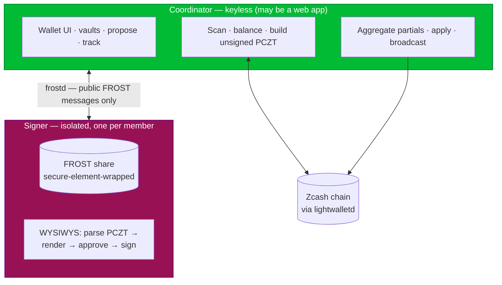

# Loki

Loki is a **shielded Zcash FROST multisig wallet**. It splits, Safe-style, into a
**keyless coordinator** that builds and tracks transactions and an **isolated signer**
that holds a member's key share and approves on-device. The share is **born in the
signer during DKG, never enters the browser**, and every member **confirms the real
transaction on their own device** before signing. Threshold signing and coordination
run on the audited Zcash Foundation FROST stack.

> Status: **test-network only, not custody.** Every build shows its network and refuses
> mainnet funds. See [`docs/product/SECURITY.md`](docs/product/SECURITY.md) for the
> pre-custody checklist.

## Architecture



The coordinator holds **public protocol messages and the vault address** — never a
share, nonce, viewing key, or spend key; the signer builds the candidate PCZT. The
signer holds exactly **one share**, wrapped by the device secure element (Secure Enclave
/ StrongBox / TPM; software fallback for dev). `frostd` relays only public FROST
messages and DKG round-two envelopes sealed under one-setup fresh keys. Any `t`-of-`n`
policy with 2 ≤ t < n ≤ 16 is supported.

Full design, threat model, and invariants: [`docs/product/`](docs/product/).

## What works today

| Area | State |
|---|---|
| General **t-of-n** DKG → sign → aggregate → verify (2 ≤ t < n ≤ 16) | ✅ `(2,3) (3,5) (15,16)` on the hosted engine and the new signer; 2-of-5 over the real relay stack |
| Keyless coordinator boundary (no share/nonce/spend key) | ✅ compile-time + deny-list enforced |
| Signer: **WYSIWYS→sighash binding**, single-use crash-safe nonces, fee integrity | ✅ tested |
| Share born-in-signer (v2 DKG: on-device roster code, fresh-key round two, ready after every backup) + **backup / restore** with nonce-epoch reset | ✅ tested |
| Transport over audited **`frostd`** (typed sends, coordinator relay log) | ✅ live 2-of-3 setup + signing through `LocalSigner` |
| Secure Enclave backend (wrap/unwrap the share key) | 🔬 spike proven ([`poc/enclave-spike`](poc/enclave-spike)) |

## Pending (pre-custody)

Real Secure Enclave / StrongBox backend + biometric gate; native app shell + web
coordinator deployment; retire the bespoke relays; external security audit; reorg/crash
and recovery-spend drills. Tracked in [`docs/product/07-roadmap.md`](docs/product/07-roadmap.md).

## Repository layout

| Path | What |
|---|---|
| `poc/src/signer/` | The isolated signer: `Signer` trait, `LocalSigner`, sealing, nonces, WYSIWYS, backup |
| `poc/src/coordinator_boundary.rs` | The keyless coordinator↔signer seam |
| `poc/src/transport.rs` | `frostd` transport |
| `poc/src/distributed_setup.rs`, `candidate.rs`, `signing_session.rs` | General t-of-n DKG + signing |
| `poc/src/scan.rs`, `witness.rs`, `loki_wallet_sync` | Chain scan / balance (coordinator) |
| `web/wallet/` | Next.js wallet UI + keyless coordinator (public roster) |
| `poc/loki-signer-wasm/` | The signer core compiled to wasm — runs in the browser (`web/wallet`) |
| `poc/wasm-transport/` | Browser `frostd` transport (wasm), loaded lazily for DKG/payment |
| `poc/wallet/design/` | Wallet UI design prototype |
| `poc/enclave-spike/` | Secure Enclave feasibility spike |
| `communication/` | Bespoke relay stack (being retired in favour of `frostd`) |
| `docs/product/` | Architecture, per-workstream specs, security, roadmap, design |

## Build & test

The crypto core builds with Cargo; threshold tests exercise the audited FROST crates.

```sh
cd poc
cargo test --locked
```

Preview the wallet UI design prototype:

```sh
poc/wallet/design/serve.sh   # then open http://localhost:8080/design/
```

## In-browser signer (web wallet)

The signer in [`poc/loki-signer-wasm`](poc/loki-signer-wasm) compiles the FROST signer core
to wasm and runs **inside the browser tab** of the [`web/wallet`](web/wallet) Next app — there
is no local member process and no `127.0.0.1` pairing link. The device identity is sealed under
a **passkey (Touch/Face ID, security key, or phone) or passphrase** and persisted to the
browser's **OPFS**; the FROST core runs in a Web Worker, and the share is born in it during DKG
and never enters page JavaScript. A browser member has completed a real **2-of-3 DKG** over the
live `frostd` relay. See [`web/wallet/README.md`](web/wallet/README.md) for the signer seam.

**Run it:**

```sh
# 1. Build the two wasm bundles (gitignored; a copy step stages them into the app):
cd poc/loki-signer-wasm && RUSTFLAGS='--cfg getrandom_backend="wasm_js"' wasm-pack build --dev --target web
cd ../wasm-transport    && wasm-pack build --target web

# 2. Run the wallet (predev/prebuild copies the bundles into web/wallet/public/signer/):
cd ../../web/wallet && npm install && npm run dev   # → http://localhost:3000
```

Open `http://localhost:3000` and create or unlock your signer (passkey or passphrase) to reach
Home — this **onboarding works standalone**. If the wasm bundles are not built, the app serves a
mock signer that services onboarding only and reports vault/DKG/payment paths as unbuilt.

**Full ceremony requires a live coordinator + `frostd`.** Creating/joining a vault and signing
need a reachable `frostd` over **https/wss with CORS** (a browser cannot use a loopback-plaintext
relay) and a vault invite from a creator member. Point the app at your relay with
`NEXT_PUBLIC_FROSTD_URL` (the transport module defaults to the served
`/signer/wasm-transport/pkg/loki_wasm_transport.js`). The joiner adopts the creator's
`birth_height` from its published session, so the DKG setup document matches byte-for-byte.

Use only disposable test-network funds.
