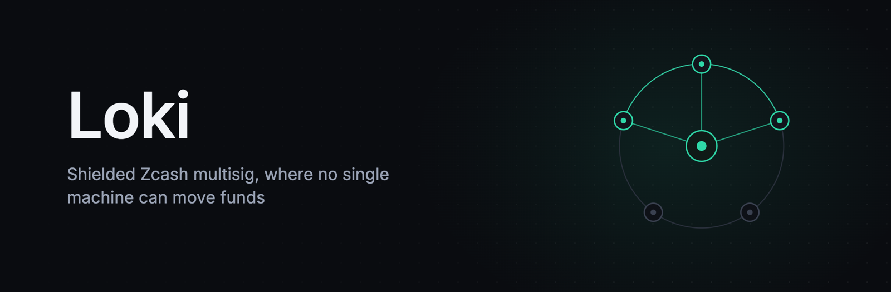
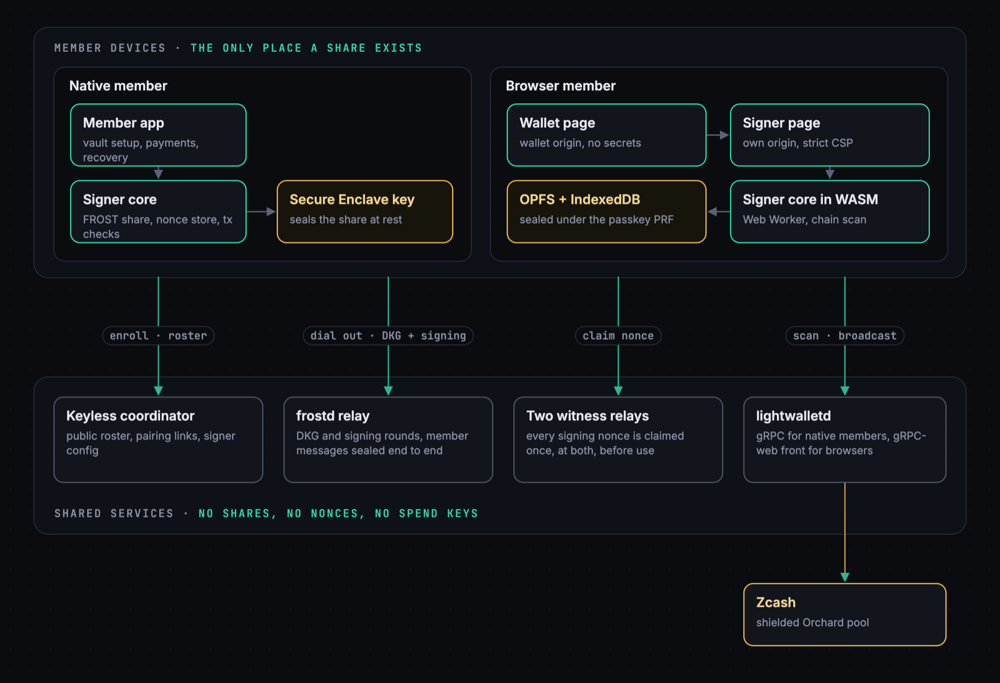
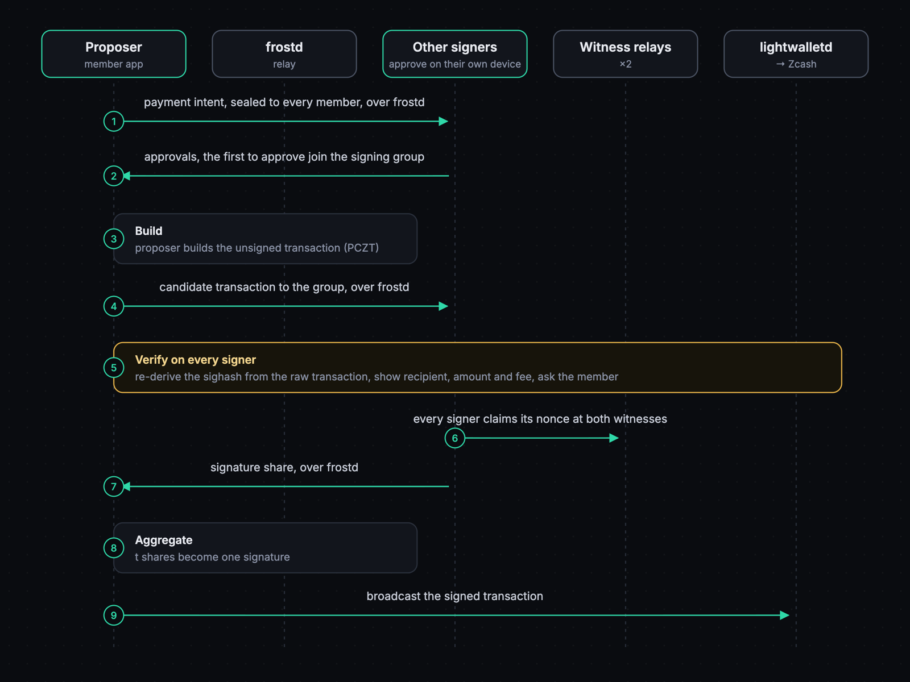

> [!WARNING]
> **Testnet only**, Loki is not ready for real funds and refuses mainnet, use disposable
> testnet ZEC.

# Loki

**A shielded Zcash multisig wallet where no single machine can move funds.**

Loki splits a vault's spending key into FROST shares, one per member, and any `t` of the
`n` members must approve and sign a payment together, fewer than `t` cannot spend and no
server ever holds a share.

## How it works

- **Vaults are t-of-n**, any policy with `2 ≤ t < n ≤ 16`.
- **Shares are born on the member's device**, members run a dealerless key generation
  (DKG), each share is created inside that member's signer and only ever leaves it as an
  encrypted backup, and all members end up with the same vault address.
- **Members check who they are signing with**, everyone compares a 24-digit roster code
  out of band before keys are generated, so nobody can slip in an extra member.
- **Every signer checks the real transaction**, before signing, each member's signer
  rebuilds the transaction hash from the raw transaction and shows the recipient, amount
  and fee it is about to sign, and anything that doesn't match is refused.
- **The coordinator holds no keys**, it publishes the roster and pairing links, with no
  share, nonce or spend key, so it cannot sign anything on its own.
- **Signing goes through a relay**, key generation and signing rounds pass through a
  [`frostd`](https://github.com/ZcashFoundation/frost) relay that every member connects
  out to, with member-to-member messages sealed end to end.
- **Nonces are single-use**, before using a signing nonce, each signer claims it at two
  independent witness relays, so the same nonce can never sign twice, even from a restored
  or cloned device.

## Two kinds of signer

| | Native | Browser |
|---|---|---|
| Where the share lives | On the member's machine, on macOS LokiSigner seals it under a Secure Enclave key | In the browser's private storage, sealed under a passkey or passphrase |
| Approving a payment | A dialog in LokiSigner, with Touch ID to open the share | A signer page on its own origin, with a passkey prompt |

The browser signer runs the same signer core compiled to WebAssembly, on a separate origin
from the wallet, and whoever controls the site that serves it could capture the share.

## A payment, end to end

1. A member proposes a payment in the wallet.
2. Every member sees the request, and the proposer plus the first `t − 1` other members to
   approve form the signing group.
3. The proposer's app builds the unsigned transaction and sends it to the group.
4. Each signer re-derives what it is signing, shows it and asks its member to approve.
5. Each approving signer produces a signature share, the shares are combined into one
   signature and the transaction is broadcast.

A failed payment can be retried or cancelled, and since a retry spends the same note, at
most one of them is ever mined.

## Try it

Build the browser signer once, then run the wallet:

```sh
cd core/loki-signer-wasm && RUSTFLAGS='--cfg getrandom_backend="wasm_js"' wasm-pack build --dev --target web
cd ../wasm-transport    && wasm-pack build --target web
cd ../../web/wallet     && npm install && npm run dev        # wallet, http://localhost:3001
```

Then, from `web/wallet` in a second terminal, serve the signer on its own origin:

```sh
LOKI_FROSTD_URL=http://127.0.0.1:2744 npm run signer           # signer, http://localhost:3002
```

The relays need CORS for the signer origin, see
[`web/wallet/README.md`](web/wallet/README.md) for the full setup,
[`communication/deploy/`](communication/deploy/) for deploy scripts and
[`core/signer-app/README.md`](core/signer-app/README.md) to build the macOS signer.

## Architecture

Secrets stay on member devices, and the shared services only ever see public or sealed
data.



A payment, from proposal to broadcast:



Built on the Zcash Foundation's audited FROST crates and its `frostd` relay.

## Build and test

```sh
(cd core && cargo test --locked --lib)
(cd web/wallet && npm test)
```
