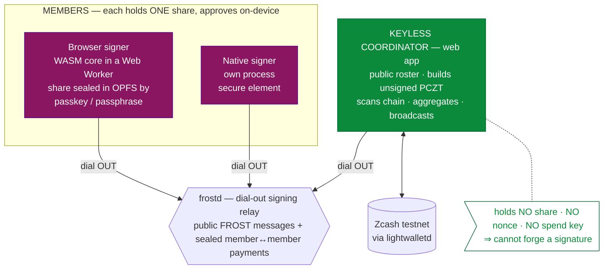

# Loki

Loki is a **shielded Zcash FROST multisig wallet** built so that **no single machine can
move funds**. It splits into two parts: a **keyless coordinator** — a web app that tracks
vaults and payments and holds no FROST share, nonce or spend key — and, for each member,
an **isolated signer** that holds exactly one FROST key share and approves on-device. A
share is **born during DKG inside the signer and never leaves it**, and every member **re-derives and
confirms the real transaction** before adding their signature. The threshold crypto is the
audited **Zcash Foundation FROST** stack.

A member's signer runs **in their browser**: a WebAssembly build of the signer core, with
the share sealed by a **passkey (Touch/Face ID, security key, or phone) or passphrase** and
persisted to the browser's private storage (OPFS). No install, no `127.0.0.1` pairing link —
a member joins a vault and signs from a web page. A **native per-device signer** process is
also supported for members who prefer to run their own.

> **Status: test-network only — not custody.** Every build shows its network and refuses
> mainnet funds. See [`docs/product/SECURITY.md`](docs/product/SECURITY.md) for the
> pre-custody checklist.

## How it works

A vault is a **t-of-n** group (any `2 ≤ t < n ≤ 16`). Its lifecycle:

1. **Create a signer.** A member opens the wallet and creates a signer — a device identity
   sealed by a passkey or passphrase in the browser's OPFS. The platform never sees it.
2. **Create or join a vault.** One member creates the vault and shares an invite code; each
   other member joins with it.
3. **DKG.** The members run a dealerless distributed key generation over `frostd`. Each
   signer's **share is born locally** and sealed; all members derive the **same vault
   address**. They compare a shared **roster fingerprint** out of band to rule out
   substitution.
4. **Fund.** Send testnet ZEC to the vault address; the coordinator scans the chain and
   reports the balance.
5. **Pay.** A member proposes a send, and every member can approve it. The proposer and
   the first `t − 1` other members to approve form the signing group; nobody is chosen in
   advance. The coordinator builds the unsigned transaction (PCZT). Each signer in the group
   **re-derives the sighash from the raw transaction, sees exactly what it is signing
   (WYSIWYS), and signs** — producing a signature share over `frostd`. The coordinator
   aggregates `t` shares into one re-randomized signature and **broadcasts**.

## Architecture



The invariants behind the picture:

- **Keyless coordinator.** It never holds a share, nonce, or spend key
  ([`poc/src/coordinator_boundary.rs`](poc/src/coordinator_boundary.rs), compile-time +
  deny-list enforced) — so it **cannot forge a signature** on its own. It is not
  view-blind: the candidate PCZT carries the vault viewing key in each Orchard spend
  ([`poc/vendor/zakura-orchard/src/builder.rs:517`](poc/vendor/zakura-orchard/src/builder.rs)),
  so whatever holds the candidate can see the vault's payments.
- **WYSIWYS.** The proposer's signer builds the candidate PCZT
  ([`poc/loki-signer-core/src/signer/coordination.rs:105`](poc/loki-signer-core/src/signer/coordination.rs));
  every member **re-derives the sighash and refuses any mismatch** before signing
  ([`poc/src/host/payment.rs:349`](poc/src/host/payment.rs)).
- **Private payments.** Payment details stay **member↔member, sealed, and carried over
  `frostd`** — the coordinator never sees them.
- **Dial-out relay.** `frostd` is the signing relay; coordinator and members connect
  **outbound** to it, so a member needs **zero inbound** — a browser tab suffices.
- **Substitution defence.** Roster-fingerprint verification binds the DKG to the agreed set
  of members ([`poc/src/host/ceremony.rs`](poc/src/host/ceremony.rs)).
- **In-browser custody (testnet only by policy).** The share is born in a Web Worker during
  DKG and is sealed under the passkey's WebAuthn-PRF secret (or an Argon2id passphrase key)
  before it touches OPFS. The passphrase and the PRF output pass through page JavaScript
  on their way to the worker ([`web/wallet/src/lib/signer.ts:177`](web/wallet/src/lib/signer.ts)),
  and the coordinator site serves the page and worker code that holds the share, so whoever
  controls that origin can capture both. That is why the browser signer is testnet-only.

## Try it

Testnet only, on the shared [ZF FROST](https://github.com/ZcashFoundation/frost) `frostd`
relay.

**In the browser (the default).** Build the two wasm bundles once, then run the wallet; a
member creates a signer and joins a vault from the web page:

```sh
# 1. Build the wasm bundles (gitignored; a predev/prebuild step stages them into the app):
cd poc/loki-signer-wasm && RUSTFLAGS='--cfg getrandom_backend="wasm_js"' wasm-pack build --dev --target web
cd ../wasm-transport    && wasm-pack build --target web

# 2. Run the wallet:
cd ../../web/wallet && npm install && npx next dev --hostname localhost -p 3001   # → http://localhost:3001
```

The wallet and the signer are served from separate origins; see
[`web/wallet/README.md`](web/wallet/README.md) for the two-origin setup.

Open the app and **create or unlock your signer** (passkey or passphrase) to reach Home —
this onboarding works standalone. Creating/joining a vault and signing additionally need a
reachable `frostd` over **https/wss with CORS** (a browser cannot use a loopback-plaintext
relay) and a vault invite from the creator. Point the app at your relay with
`NEXT_PUBLIC_FROSTD_URL`. If the wasm bundles are absent, the app serves a mock signer that
services onboarding only and reports vault/DKG/payment paths as unbuilt.

**Native members (alternative).** One person hosts the keyless coordinator; each participant
joins with one command:

```sh
communication/deploy/public-testnet.sh /absolute/new/pub-stack     # host → prints the coordinator URL
communication/deploy/join-loki.sh      https://<random>.trycloudflare.com   # each member
```

Then, together in the coordinator UI: create a vault → verify every member (compare the
roster fingerprint out of band) → fund from a [testnet faucet](https://faucet.zecpages.com/)
→ propose a send; any members review and approve on their own devices, and the first `t`
(including the proposer) sign → broadcast.

Use only disposable test-network funds. Full design, threat model, and invariants:
[`docs/product/`](docs/product/).

## What works today

| Area | State |
|---|---|
| General **t-of-n** DKG → sign → aggregate → verify (`2 ≤ t < n ≤ 16`) | ✅ on the hosted engine and the native relay stack |
| **In-browser WASM signer**: create/unlock (passkey or passphrase), OPFS custody, share-born-in-worker | ✅ onboarding + a real **2-of-3 browser DKG** over live `frostd` |
| Keyless coordinator boundary (no share / nonce / spend key) | ✅ compile-time + deny-list enforced |
| Signer **WYSIWYS → sighash binding**, single-use crash-safe nonces, fee integrity | ✅ tested (native); enforced in the WASM core |
| Transport over audited **`frostd`** (typed sends, coordinator relay log) | ✅ live 2-of-3 setup + signing |
| Browser-signed **payment** (review → approve → broadcast) | 🔬 in progress on `feat/wasm-signer` |
| Secure Enclave backend (wrap/unwrap the share key) | 🔬 spike proven ([`poc/enclave-spike`](poc/enclave-spike)) |

## Pending (pre-custody)

Browser-signed payment end-to-end; real Secure Enclave / StrongBox backend + biometric gate;
retire the bespoke relays in favour of `frostd`; external security audit; reorg/crash and
recovery-spend drills. Tracked in
[`docs/product/07-roadmap.md`](docs/product/07-roadmap.md).

## Repository layout

| Path | What |
|---|---|
| `web/wallet/` | Next.js wallet UI **and** keyless coordinator (public roster); the in-browser signer loads here |
| `poc/loki-signer-wasm/` | The signer core compiled to wasm + the Web Worker that runs it in the browser |
| `poc/wasm-transport/` | Browser `frostd` transport (wasm), loaded lazily for DKG/payment |
| `poc/loki-signer-core/src/signer/` | The isolated signer: `Signer` trait, `LocalSigner`, sealing, nonces, WYSIWYS, backup |
| `poc/src/host/` | The native member app: ceremony, payment, recovery, device pairing + its HTTP routes |
| `poc/src/coordinator_boundary.rs` | The keyless coordinator↔signer seam |
| `poc/src/transport.rs` | `frostd` transport (native) |
| `poc/loki-signer-core/src/distributed_setup.rs`, `candidate.rs`, `signing_session.rs` | General t-of-n DKG + signing primitives |
| `poc/src/scan.rs`, `witness.rs` | Chain scan / balance (coordinator) |
| `poc/enclave-spike/` | Secure Enclave feasibility spike |
| `communication/deploy/` | Deploy scripts: `public-testnet.sh` (host), `join-loki.sh` / `run-member.sh` (join) |
| `communication/` | Bespoke relay stack (being retired in favour of `frostd`) |
| `docs/product/` | Architecture, per-workstream specs, security, roadmap, design |

The threshold crypto core is the audited Zcash Foundation FROST crates (`frost-core`,
`reddsa` with `frost`; see [`poc/Cargo.toml`](poc/Cargo.toml)); `frostd` is the ZF signing
relay, run as an external service — Loki does not fork or vendor it.

## Build & test

```sh
cd poc
cargo test --locked                 # threshold crypto core + signer/host
```

See [`web/wallet/README.md`](web/wallet/README.md) for the coordinator↔signer seam and the
wasm staging step.
