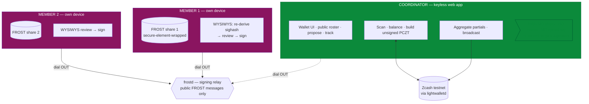

# Loki

Loki is a **shielded Zcash FROST multisig wallet**. It splits, Safe-style, into a
**keyless coordinator** that builds and tracks transactions and an **isolated signer**
that holds a member's key share and approves on-device. The share is **born in the
signer during DKG, never enters the browser**, and every member **confirms the real
transaction on their own device** before signing. Threshold signing and coordination
run on the audited Zcash Foundation FROST stack.

> Status: **test-network only, not custody.** Every build shows its network and refuses
> mainnet funds. See [`docs/product/SECURITY.md`](docs/product/SECURITY.md) for the
> pre-custody checklist.

## Architecture



Each member runs **their own signer on their own device**, holding exactly **one
share** wrapped by the device secure element (Secure Enclave / StrongBox / TPM;
software fallback for dev). The **keyless coordinator** holds only public protocol
messages and the vault address — never a share, nonce, viewing key, or spend key
([`poc/src/coordinator_boundary.rs`](poc/src/coordinator_boundary.rs), compile-time +
deny-list enforced) — so it **cannot forge a signature** on its own. It builds the
candidate PCZT; every member **re-derives the sighash and refuses any mismatch** before
signing ([`poc/src/host/payment.rs:342`](poc/src/host/payment.rs)). Payments stay
**member↔member, sealed, and carried over `frostd`** — the coordinator never sees them
([`poc/src/host/payment.rs`](poc/src/host/payment.rs)). `frostd` is the **dial-out**
signing relay: coordinator and members connect **outbound** to it, so members need **zero
inbound**. Roster-fingerprint verification defends against DKG substitution
([`poc/src/host/ceremony.rs`](poc/src/host/ceremony.rs)). Any `t`-of-`n` policy with
2 ≤ t < n ≤ 16 is supported.

## Try it out

Testnet only, on the shared [ZF FROST](https://github.com/ZcashFoundation/frost)
`frostd` relay. **Each signer runs their own member** — self-custody. (There is no
sign-by-just-visiting yet; the in-browser WASM signer that would enable it is in
development on `feat/wasm-signer`.)

1. **One person hosts the coordinator.** It is keyless, so it holds nothing:

   ```sh
   communication/deploy/public-testnet.sh /absolute/new/pub-stack
   # -> coordinator LIVE:  https://<random>.trycloudflare.com
   ```

2. **Each participant joins with one command**, against that URL, then opens the
   printed local link and pastes it into the coordinator web UI to pair their device:

   ```sh
   communication/deploy/join-loki.sh https://<random>.trycloudflare.com
   # first run builds the member binary (a few minutes); auto-picks the next free slot
   # -> open in a browser to pair this device: http://127.0.0.1:361X/#<token>
   ```

3. **Together**, in the coordinator UI: create a **2-of-3** vault → **verify** every
   member (compare the roster fingerprint out of band) → **fund** the vault address from
   a [testnet faucet](https://faucet.zecpages.com/) → **propose a send**; each required
   signer reviews the real transaction on their own device and **approves** →
   **broadcast**.

Full design, threat model, and invariants: [`docs/product/`](docs/product/).

## What works today

| Area | State |
|---|---|
| General **t-of-n** DKG → sign → aggregate → verify (2 ≤ t < n ≤ 16) | ✅ `(2,3) (3,5) (15,16)` on the hosted engine and the new signer; 2-of-5 over the real relay stack |
| Keyless coordinator boundary (no share/nonce/spend key) | ✅ compile-time + deny-list enforced |
| Signer: **WYSIWYS→sighash binding**, single-use crash-safe nonces, fee integrity | ✅ tested |
| Share born-in-signer (v2 DKG: on-device roster code, fresh-key round two, ready after every backup) + **backup / restore** with nonce-epoch reset | ✅ tested |
| Transport over audited **`frostd`** (typed sends, coordinator relay log) | ✅ live 2-of-3 setup + signing through `LocalSigner` |
| Secure Enclave backend (wrap/unwrap the share key) | 🔬 spike proven ([`poc/enclave-spike`](poc/enclave-spike)) |

## Pending (pre-custody)

Real Secure Enclave / StrongBox backend + biometric gate; native app shell + web
coordinator deployment; retire the bespoke relays; external security audit; reorg/crash
and recovery-spend drills. Tracked in [`docs/product/07-roadmap.md`](docs/product/07-roadmap.md).

## Repository layout

| Path | What |
|---|---|
| `poc/src/signer/` | The isolated signer: `Signer` trait, `LocalSigner`, sealing, nonces, WYSIWYS, backup |
| `poc/src/coordinator_boundary.rs` | The keyless coordinator↔signer seam |
| `poc/src/transport.rs` | `frostd` transport |
| `poc/src/distributed_setup.rs`, `candidate.rs`, `signing_session.rs` | General t-of-n DKG + signing |
| `poc/src/scan.rs`, `witness.rs`, `loki_wallet_sync` | Chain scan / balance (coordinator) |
| `poc/wallet/design/` | Wallet UI design prototype |
| `poc/enclave-spike/` | Secure Enclave feasibility spike |
| `web/wallet/` | The keyless coordinator web app (Next; `node server.js`) |
| `communication/deploy/` | Deploy scripts: `public-testnet.sh` (host), `join-loki.sh` / `run-member.sh` (join) |
| `communication/` | Bespoke relay stack (being retired in favour of `frostd`) |
| `docs/product/` | Architecture, per-workstream specs, security, roadmap, design |

The threshold crypto core is the audited Zcash Foundation FROST crates
(`frost-core`, `reddsa` with `frost`; see [`poc/Cargo.toml`](poc/Cargo.toml)); `frostd`
is the ZF signing relay, run as an external service — Loki does not fork or vendor it.

## Build & test

The crypto core builds with Cargo; threshold tests exercise the audited FROST crates.

```sh
cd poc
cargo test --locked
```

Preview the wallet UI design prototype:

```sh
poc/wallet/design/serve.sh   # then open http://localhost:8080/design/
```

Use only disposable test-network funds.
