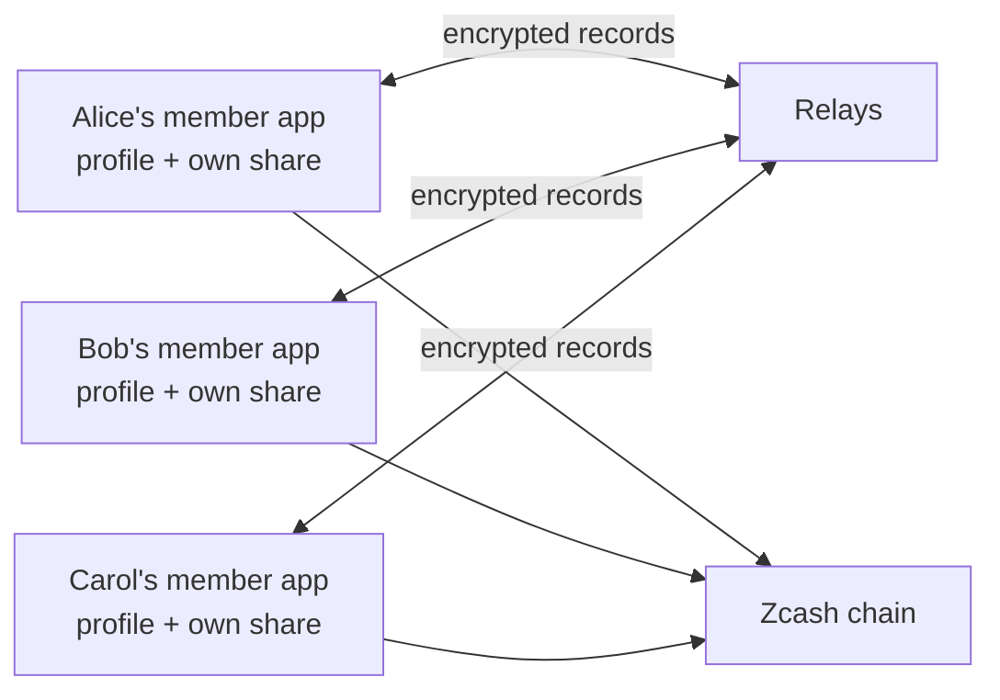

# Building Loki as a member-owned wallet

Status: implementation plan for the first usable wallet flow, not a custody release. The member setup app under `poc/wallet/` now has one local profile per process and a separate identity and sealed share for each vault membership. It covers create, join, roster comparison, DKG, backup activation, receive address and a manual chain balance scan. Its profile is **not yet linked to an existing Zcash account**. It still uses a local file courier and a simultaneous setup round. Persistent chain sync, payment screens, asynchronous relays, recovery, account connection and passkey unlock remain to be implemented.

## Intent and scope

A person opens Loki as themselves, creates or unlocks a local profile, creates or joins a vault, and sees only the vaults in which that profile is a member. They can receive, propose, review, approve, and follow payments from their own app. A vault has a fixed member roster and threshold after activation. For the first implementation, the supported configuration is 2-of-3; names, devices, proposer, approvers, and finisher are chosen by people and protocol state, not assigned to Alice, Bob, and Carol in code. A later measured release may add 2-of-4.

“Zcash account” means an account controlled by a person's existing seed wallet. “Loki profile” means the local app state that lists that person's vault memberships. A profile may belong to several vaults, but the current random profile ID and passphrase do not prove control of a Zcash account. The product flow must link a supported wallet account cryptographically before treating it as connected. No remote Loki service holds a member's seed, share or viewing key.

**Account connection is separate from vault signing.** Loki shows a QR or deep link containing a fresh, expiring, domain-separated challenge, the intended vault, the member's new vault-specific public identity and requested permissions. A compatible wallet approves it and returns a verifiable proof of control of the selected account, without disclosing its seed. Loki verifies that proof locally; the setup certificate contains the vault-specific identity, not the person's ordinary payment address or reusable account key. One wallet account can join several vaults with different member identities. Scanning a Unified Address QR alone only supplies an address; it is not proof of control. An ordinary Zcash wallet also cannot produce a Loki FROST share merely by connecting: the member's Loki signer generates that share in the group DKG. For a wallet to hold and use the share itself, it must implement Loki's FROST signing and safe nonce-storage protocol.

Recovery has a second capability requirement. The DKG share is not deterministically recoverable from the personal wallet seed. If a connected wallet can derive a domain-separated per-vault wrapping key, the member's encrypted backup card can be recovered with that wallet plus the card; otherwise the existing 24-word-and-card backup remains required. Loki must never suggest that scanning an address or restoring only the personal wallet seed restores the vault. It must not reuse a personal payment address or one public identity across vault rosters, because that would link memberships. A QR connector is implemented against one verified wallet capability at a time; the interface lists supported wallets and does not claim every Zcash wallet works.

The first implementation targets regtest. Test funding and mining are developer controls outside the member journey. No screen offers “add one test ZEC” as if it were a wallet action.

## Member journey

1. **Open / connect / unlock.** A person connects a supported Zcash wallet by scanning Loki's challenge QR and approving it in that wallet. Loki verifies the wallet's response before linking it to the local profile. Returning people unlock the profile and can reconnect the wallet. The app shows **Create vault**, **Join vault**, and their vault list. A fresh transport identity is created for each vault; the profile does not publish one stable identity across all its vaults. The current passphrase-only regtest profile is a development path, not evidence that wallet connection works.
2. **Create vault.** The creator enters a name and selects the supported 2-of-3 policy. The app makes a random vault ID and two invite links. The creator is one member by default. It shows three slots and who has accepted; the vault is a draft with no receive address.
3. **Join.** Each invitee opens the link in their own app, creates or unlocks a profile, sees the vault name, threshold, inviter identity and their assigned slot, then accepts. The bearer secret stays in the link fragment, expires, and can claim a slot only once. If someone else claims it first, the roster comparison must reveal the wrong identity and setup stops. Member labels are display names; the certified public keys and slot IDs are the identities the protocol checks.
4. **Agree and create keys.** Once all slots are filled, every app shows the same roster fingerprint and short comparison code. Each member confirms it against the others through an existing trusted channel. The apps run the existing dealerless DKG over authenticated, encrypted relay messages. DKG progress survives app restarts and does not require everyone to keep a tab open together. A mismatch or timeout stops setup and names the action needed; it never publishes a receive address.
5. **Back up.** Each member saves their own 24 words and backup card and proves they can load them. Each app publishes its signed backup confirmation. The vault becomes **Active** and reveals the shared receive address only when all three certificates and backup confirmations agree.
6. **Use the vault.** The overview shows balance at a named chain height, receive address, member list, pending payments and history. Funding comes from an external sender or a developer faucet in regtest. Each member syncs the chain for themselves.
7. **Propose.** Any member enters recipient, amount and memo. The app shows fee, change and expiry. The proposer does not choose a signing pair. The proposal fixes one payment intent and its notes and effects. The first wallet uses fresh signing commitments, sealed in each member's store, and a second visit when a candidate is ready; it does not promise one-visit approval. As commitments arrive, the clients build a candidate for each eligible pair, all bound to that intent. The first visit publishes a commitment and is labelled **Preparing**, not **Approved**.
8. **Review and approve.** Each member sees the candidate in their own inbox. Their signer rebuilds and checks every candidate that may use their share, returns the verified display, and asks for explicit approval plus unlock. A refusal is a member decision, not a veto. A share is released only for the exact checked package under the existing nonce and relay-receipt rules. Any two eligible members can complete the proposal, with the required return visit shown before anyone acts.
9. **Send and confirm.** Once a candidate has two valid shares, any synced member app can install the current anchor, prove, share the final bytes and broadcast. Each app marks **Confirmed** only after its own chain sync sees the mined payment; a reorg rolls the chain status back.
10. **Recover / leave.** A member restores from their own words and card on a new device. Leaving or removing a compromised member creates a new vault and sweeps funds; changing a label does not change the cryptographic roster.

For Alice, this means she can create the vault and also approve a payment later, but neither action makes her a permanent proposer or signer. Bob can propose while Alice and Carol approve, then finish without holding either approval share.

The app navigation follows this ownership: **Connect wallet → Profile → Vault list → Create or join → Setup and backup → Vault overview / Receive / Payments / History**. There is no Alice/Bob/Carol switcher, coordinator link, or panel showing another member's private review. **Create vault** starts a draft; it cannot fabricate the invitees' profiles, accept for them, or check their backups. A test faucet and block mining live in developer tools, outside these screens.

## Boundaries and state

Each member app has one local profile store, one sealed vault-share store per membership, a viewing and chain-sync store, and an outbox/inbox. It may read only its own secret store. Relays retain ciphertext and receipts, and do not create vaults, choose signers, hold shares or act as a coordinator. The chain is the source of truth for balances and confirmation. A local app service may host the interface for the first native client, but each member runs a separate service and data root; no shared process owns all members. Separate directories under one OS user are useful for organization, but are not a security boundary; isolation tests use separate OS users, sandboxes or devices.

App delivery is part of custody. A hosted origin can change its code and read unlocked keys. Workers inside that origin do not protect its members from the host. A custody design needs an independently delivered app in every possible approving pair and must count every device each member uses; the regtest flow below is not a custody claim.

The durable objects are `Profile` (local identity and unlock), `AccountConnection` (the verified, scoped wallet capability and its expiry), `VaultDraft` (invite slots and setup progress), `VaultCertificate` (roster, threshold, group key, vault-specific member identities and confirmations), `VaultMembership` (this member's sealed share and backup epoch), `PaymentIntent` (exact effects), `Candidate` (one quorum's transaction and signing packages), and `ApprovalRecord` (one member's exact signed packages and relay receipts). The UI reads these states; it does not infer authority from an address QR, screen name or browser URL token.

Vault states are **Draft → Waiting for members → Verifying roster → Creating keys → Backing up → Active**, with explicit **Stopped** on disagreement. Payment states are **Draft → Collecting commitments → Waiting for approvals → Ready to send → Broadcast → Confirmed**; chain observations can return to an earlier pending state after a reorg. An expired, conflicting, declined or failed attempt says why and how to make a new proposal. Neither setup nor a payment silently restarts with reused signing material.

## Decisions and trade-offs

| Decision | Reason and consequence |
| --- | --- |
| Member-owned client, one store per person | This is the ownership boundary the current demo lacks. The first working client can reuse Rust through a local app service and browser interface. A browser-only WASM signer remains a separate custody-client decision; moving the code into a web worker does not by itself isolate it from its origin. |
| Invite and roster before DKG | Slot IDs and identity keys become immutable before anyone generates shares. Replacing a member during setup aborts and starts a new draft. This adds a setup step but prevents an invite or label change from silently changing the group key. |
| All eligible pairs per proposal | A 2-of-3 payment must not lock Bob out because Alice selected AC in a form. Candidates can appear as fresh commitments arrive, up to three for this configuration. This reuses the candidate and FROST primitives but needs new orchestration and tests. Preprocessed one-visit signing waits for the nonce-use witness and real-device crash gate. |
| Keep the test harness | `poc/demo/member_demo.py` and `poc/run-member-payment.py` remain disposable integration tools. Product screens do not call a process that creates every member store, auto-confirms all backups, funds from a faucet, or mines blocks. |
| Wallet connection is a capability, not an address import | A connector must demonstrate challenge signing with a verifiable account binding before Loki calls it connected. Seed-derived backup wrapping and wallet-held FROST are distinct optional capabilities, never inferred from a QR scan. The first adapter targets one wallet that actually exposes the needed API; additional wallets require their own compatibility checks. |

## Existing code and required changes

Reusable, subject to its existing review gates: `distributed_setup` for member DKG, `setup_transport` for authenticated sealed messages, `loki_setup_member` backup and certificate checks, `member_state` sealed membership loading, `signing_session` nonce and approval rules, the candidate builder and verifier, `scan` and `witness` as the start of local chain sync, and the relay's opaque durable delivery. Their current 2-of-3 limits are acceptable for the first supported configuration, but they must take identities from a certified roster rather than the demo's process order. The relay protocol is also currently fixed to three member IDs; that is a supported-config limit, not a reason to hardcode names in the app.

Required integration work, in order:

1. A member runtime with profile creation/unlock and a private data root. Start three isolated instances in one end-to-end test; verify that a client cannot read another's store across the chosen OS or device boundary. Expose commands to the UI for **create draft**, **accept invite**, **show setup status**, **back up**, **list vaults**, and **unlock**. No global Alice/Bob/Carol server. This local profile exists, but it is not yet a connected Zcash account.
1a. Prove one real wallet connector end to end before adding a generic **Connect wallet** button: short-lived QR challenge, wallet approval, verified account proof, replay and wrong-origin refusal, a vault-specific member identity, disconnect and reconnect. Check that the chosen wallet actually supports the proof; if it does not, choose another adapter rather than treating an address as authentication. Separately test whether it can derive a backup wrapping key or hold a FROST share, and keep the two-artifact backup until those capabilities work.
2. Persisted, resumable setup messages over the relay. Adapt the current file-exchange DKG ceremony into steps that each member app advances when it opens. Verify the roster and backup gate before activation.
3. Per-member chain scan, receive screen and balance at a named height. The developer faucet stays in test tooling.
4. Payment family creation and relay publication for all three pairs. Keep one intent and exact effects, then connect each member's independent review, nonce consumption and approval to its own inbox.
5. Finishing from any synced member and confirmation from each member's chain view. Add recovery and interrupted-session drills before calling the flow complete.
6. Replace the demo navigation with profile, vault list, create/join progress, active vault, payment inbox and verified review. The UI never receives a signing share, nonce, viewing key or signature share, and cannot request signing without the member's verified approval. The unlock flow still trusts the code delivered to that member's app.

## Acceptance for the first vertical slice

Three people connect supported Zcash accounts with separate wallet approvals, then run three isolated Loki app instances and data roots, with separate OS users, sandboxes or devices for the ownership test. A replayed QR, an address-only QR and a proof from another account are refused. Alice creates and invites Bob and Carol; each accepts and keeps only their own share. Every member sees the same certified vault and restore artifacts before its address appears. An external test sender funds it; each app independently observes the deposit. Bob proposes one payment. Alice and Carol approve from their own stores, with no pair selector and no access to Bob's or each other's secrets. Bob, who did not approve, finishes on a synced device. All three apps independently show the mined transaction. Repeat with the other two pairs and with one approver offline. Kill and restart each app at setup, approval and finishing boundaries; neither activation nor signing skips a required check. The previous all-in-one demo is not evidence for these checks.

## Release boundary

This design can produce a credible wallet flow on regtest. Real custody still depends on the existing ZIP 2005 and randomizer review, browser or native key-storage decision, physical crash and rollback tests, independent recovery spend, chain-sync and reorg validation, and an external security review. The first vertical slice must display its test-network status plainly and must not accept real funds.
