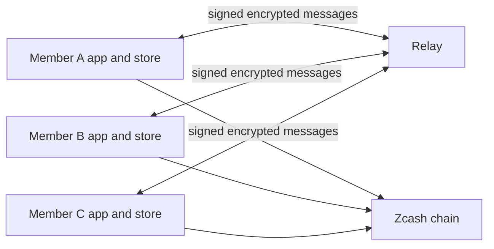

# Building Loki as a wallet

## The user flow to deliver

Three people create a 2-of-3 vault from their own apps. Each keeps only their
own share and backup. The vault receives an Ironwood note. One person proposes
a payment; any two members independently review its actual transaction effects
and approve. A synced member proves and broadcasts it, and every app learns
confirmation from its own chain scan. A member can restore from the artifacts
they were told to keep. This is the first complete wallet flow; larger quorums
and payment policies come later.

## Boundaries

- An app owns one member's share, identity key, backup, nonce state and approval
  decision. Its signer rebuilds the candidate, checks all payment effects, and
  signs only the exact package it displayed. A browser tab for another member
  cannot invoke that signer or read its store.
- A member's wallet scans the chain and derives its own balance, witnesses and
  confirmation state. A relay receipt or another member's report cannot mark a
  payment confirmed.
- The first relay carries authenticated ciphertext for proposals, commitments,
  packages and shares. It never receives a private share, passphrase, viewing
  key, plaintext payment or authority to sign. The first wallet uses fresh
  in-memory nonces and a second signing visit when needed. It does not promise
  one-visit approval. A durable nonce-use witness is a later gate for that
  feature, consistent with the [issue #7 discussion](https://github.com/amiabix/loki-zcash-frost/issues/7#issuecomment-6079101519).
- The app delivery channel is part of custody. A hosted app can be changed by
  its host and read keys when unlocked. The first custody design must keep at
  least one independently delivered member app in every approving pair, and
  count every device a member uses. Workers within one web origin do not create
  that independence.

## What can be reused

| Existing code | Product use |
| --- | --- |
| `poc/src/distributed_setup.rs`, `member_state.rs`, `zip2005.rs` | DKG, member state and restore logic after independent review of key derivation and card format |
| `poc/src/signing_session.rs`, `verify.rs`, `candidate.rs` | Candidate verification and FROST signing after the session protocol and persistent nonce state are hardened |
| `poc/src/scan.rs`, `witness.rs` | Starting point for per-member chain sync and proving; reorg and long-absence handling remain |
| `poc/src/bin/loki_member_payment.rs` | Regtest integration fixture; it hardcodes proposer 1, signers 1 and 2, finisher 3 and a 120-second mailbox wait |
| `poc/demo/` and `poc/run-member-payment.py` | Test drivers only; one process creates and can operate every member's files |

Moving files out of `poc/` does not close their security gaps. Promote a Rust
module only when its wallet-facing interface and corresponding checks exist.

## Implementation order and pass checks

1. **Independent member app boundary.** Start each member app separately with
   only that member's store. Setup and backup happen on that app. Remove the
   coordinator's Alice/Bob links and passphrase access from the user flow. Test
   with three separate app instances and deny cross-member file/API access.
2. **Encrypted message delivery.** Carry the existing signed session messages
   between member apps through a relay. Keep signing nonces fresh and in RAM;
   after a crash, abandon the unfinished signing attempt and create a new one.
   Save and resend the exact sealed shares already produced. Test delayed,
   duplicated and missing messages, app closure, and independent finishing.
   No screen may call this one-visit approval.
3. **Wallet payment loop.** Remove fixed member IDs and the 120-second signing
   deadline from the wallet path. Build the candidate family for eligible pairs,
   show each member's independently verified recipient, amount, memo, fee,
   change and expiry, then let any synced app finish. Test every pair and a
   completing approver closing immediately.
4. **Sync and recovery.** Each member discovers notes, tracks reorgs, builds
   witnesses and restores on a fresh device from their own backup. Confirm a
   payment only from that app's chain scan. Test a month-old checkpoint, a
   reorg and a restore with Loki services unavailable.
5. **Custody gate.** Validate ZIP 2005 derivation, randomizer flow, the backup
   card, browser storage and app delivery on real devices; obtain independent
   security review. Until then this remains regtest software.

Preprocessed commitments and approve-once signing can follow only after the
nonce-use witness, recovery rules and real-device crash tests are settled.
The local `poc/g3/` drills are research inputs, not that gate.

The first code slice is item 1. It changes ownership, not the visual design:
one running app must be unable to approve as a different member. The existing
regtest transaction is the regression check throughout the migration.
